# Software Design Description

*for*

**Revenue Collection and Monitoring System with AI-Integrated Logbook Scanning for NeoFit Fitness Gym**

## 1. Introduction

This Software Design Description (SDD) explains how the Revenue Collection and Monitoring System with AI-Integrated Logbook Scanning for NeoFit Fitness Gym is built to satisfy the requirements in the Software Requirements Specification (SRS). It presents the architecture of the system, the classes and modules of each part, the design of the databases, and the interaction of the components in each main function. The SRS states what the system must do; this document states how it does it, and the Software Test Document (STD) will verify the result.

NeoFit Fitness Gym records every member visit and payment by hand in a paper logbook, one “name – amount” line per entry, and these pages are its only record. The revenue for a day, a month or a year must be added up by hand, page by page, which is slow and error-prone: misread amounts and lines written twice go unnoticed, and the owner has no timely view of the gym's income. Encoding the logbook into a system by hand would be just as slow and tiring, line by line. Paper records are also hard to search and easy to lose. The design in this document turns each photographed logbook page into checked, structured records that the system can total, search and report on automatically, while the front desk keeps writing in the logbook as it does today. Invited members can also see their own membership, payments and receipts in the mobile application, and they are reminded to renew before their plans expire.

The design will guide the development of the system in the three iterations planned in the Software Project Management Plan (SPMP). The prototype screens of the system are presented in the SRS.

### 1.1. Purpose

The purpose of this document is to describe the design of the system in enough detail for the development team to build it and for the testing team to verify it. It gives the Lead Developer and the Database and QA Lead a shared picture of the components, data and interactions of the system; it gives the UI/UX Designer the screens, data and controls that each interface must provide; and it gives the advisers, the panel and NeoFit Fitness Gym a way to confirm that the planned system meets the approved requirements before development is completed.

### 1.2. Scope

This document covers the whole of the Revenue Collection and Monitoring System with AI-Integrated Logbook Scanning, version 1.0, which consists of three parts:

- **Mobile application** (React Native, Expo, TypeScript) for the staff, the owner and invited members. It captures logbook pages, reads them with a two-tier OCR engine (Google Gemini 2.5 Flash online, Google ML Kit offline), checks the amounts against NeoFit's rates, saves confirmed pages or queues them while offline, and shows the owner the revenue, the upload history and the staff accounts. Its member screens, which also run as a web version, show each member their own membership, payments and receipts, the rates and the announcements, and receive the renewal reminders.
- **Desktop application** (Electron, React, Vite, with a local Express API and a SQLite database) for the administrator at the gym's Windows computer. It manages members, their payments, rates, announcements and logbook entries, publishes the records that invited members may see, and computes revenue analytics and Word reports.
- **Supabase cloud database** (PostgreSQL, Auth, Row-Level Security and Edge Functions), the shared record that connects the two applications and the members. Its Edge Functions send the member invites and the daily renewal reminders.

The design addresses the functional requirements FR-01 to FR-14 and the non-functional requirements of the SRS. It is limited to one gym branch and to the Android and Windows platforms. The external services it relies on, the Gemini API, ML Kit, Supabase and the Expo Push Service, are described only through the interfaces that the system uses.

### 1.3. Definitions, Acronyms, and Abbreviations

The table below defines the terms, acronyms and abbreviations used in this document. Terms already defined in the SRS keep the same meaning here.

| Terms | Definition |
|---|---|
| The system | The Revenue Collection and Monitoring System with AI-Integrated Logbook Scanning for NeoFit Fitness Gym, described in this document. |
| SDD | Software Design Description. This document. |
| SRS | Software Requirements Specification. The document that states the requirements of the system. |
| Logbook | The paper notebook in which the gym staff handwrite the daily member visits and payments, one “name – amount” line per entry. |
| Logbook Scanning | Photographing a logbook page so that AI reads its entries, instead of encoding them by hand. |
| Upload | One captured logbook page together with the entries saved from it; a row of the logbook_uploads table. |
| Entry | One line of the logbook: a member name and, when written, a payment amount; a row of the logbook_entries table. |
| OCR | Optical Character Recognition. Technology that converts the text in an image into machine-readable text. |
| Gemini 2.5 Flash | A multimodal AI model by Google, used through the Gemini API to read logbook pages when the phone is online. |
| ML Kit | Google's on-device machine learning library, used to read logbook pages when the phone is offline. |
| Rate Table | NeoFit's official price list: regular or student/senior plan, with or without treadmill, per month, half-month or day. |
| Offline Queue | Storage on the phone that holds confirmed pages until they can be uploaded to the cloud database. |
| Reconciliation | Combining the revenue from the logbook scans and the member payments so that each payment is counted only once. |
| Member Screens | The part of the mobile application for invited gym members: Home, Payments, and Rates and announcements. |
| Invite | An email sent by Supabase Auth, at the administrator's request, that creates a member's sign-in account and contains a sign-in link. |
| Email Link Sign-In | Signing in without a password: Supabase Auth emails a one-time link that signs the user in when it is opened. |
| Receipt | The record of one member payment, with a receipt number in the form YYYY-MMDD-NN. It acknowledges the payment and is not an official receipt of the Bureau of Internal Revenue (BIR). |
| Renewal Reminder | A push notification that tells a member that the plan expires in 7, 3 or 1 days. |
| Push Token | The address of one phone in the Expo Push Service, used to send it push notifications. |
| Expo Push Service | The notification service of the Expo platform, which delivers push notifications to Android phones. |
| Edge Function | A small program that runs inside Supabase, on request or on a schedule. The system uses two: member-access and send-reminders. |
| pg_cron | The PostgreSQL job scheduler that Supabase uses to run the send-reminders function every day. |
| Outbox | The sync_outbox table on the desktop, which lists the changes to members, payments and rates that still have to be published to the cloud database. |
| Architecture | The overall structure of the system: its parts, their responsibilities and how they communicate. |
| Class Diagram | A UML diagram that shows the classes or modules of a system, their attributes and operations, and their relationships. |
| Sequence Diagram | A UML diagram that shows the messages exchanged by participants, in time order, to carry out one function. |
| ERD | Entity-Relationship Diagram. A diagram of the tables of a database and the relationships between them. |
| Stereotype | A UML label in guillemets, such as «screen» or «module», that states the kind of element shown. |
| API | Application Programming Interface. A defined way for one program to request services or data from another. |
| REST | Representational State Transfer. A style of web API in which resources are read and changed with HTTP methods such as GET, POST, PUT and DELETE. |
| JWT | JSON Web Token. A signed token that proves a user has signed in; the desktop API accepts requests only with a valid token. |
| bcrypt | A password-hashing function. The desktop application stores only bcrypt hashes of passwords. |
| RLS | Row-Level Security. A PostgreSQL feature that restricts which rows each user may read or change. |
| PK / FK / UK | Primary key, foreign key and unique key of a database table. |
| UUID | Universally Unique Identifier. A 128-bit identifier, written as 36 characters, used as the key of the cloud tables. |
| CSV | Comma-Separated Values. A plain-text file format for tabular data. |
| UI | User Interface. |

*Table 1.0 Definition of Terms*

### 1.4. References

[1] IEEE, “IEEE Std 1016-2009: IEEE Standard for Information Technology – Systems Design – Software Design Descriptions.” 2009.  
[2] Capstone Project Team, “Software Requirements Specification for the Revenue Collection and Monitoring System with AI-Integrated Logbook Scanning for NeoFit Fitness Gym,” Trinidad Municipal College, October 2026.  
[3] Capstone Project Team, “Software Project Management Plan for the Revenue Collection and Monitoring System with AI-Integrated Logbook Scanning for NeoFit Fitness Gym,” Trinidad Municipal College, October 2026.  
[4] Object Management Group, “OMG Unified Modeling Language (OMG UML), Version 2.5.1.” December 2017.  
[5] Google, “Gemini API Documentation.” Web. https://ai.google.dev/gemini-api/docs Accessed 2026.  
[6] Google, “ML Kit Text Recognition v2.” Web. https://developers.google.com/ml-kit/vision/text-recognition/v2 Accessed 2026.  
[7] Supabase, “Supabase Documentation: Database, Auth and Row Level Security.” Web. https://supabase.com/docs Accessed 2026.  
[8] Supabase, “Edge Functions” and “Scheduling Edge Functions.” Web. https://supabase.com/docs/guides/functions Accessed 2026.  
[9] Expo, “Push notifications overview.” Web. https://docs.expo.dev/push-notifications/overview/ Accessed 2026.  
[10] Meta Platforms, Inc., “React Native Documentation.” Web. https://reactnative.dev/docs/getting-started Accessed 2026.  
[11] OpenJS Foundation, “Electron Documentation.” Web. https://www.electronjs.org/docs Accessed 2026.  
[12] OpenJS Foundation, “Express 5.x API Reference.” Web. https://expressjs.com/en/5x/api.html Accessed 2026.  
[13] SQLite Consortium, “SQLite Documentation.” Web. https://www.sqlite.org/docs.html Accessed 2026.  
[14] OWASP Foundation, “OWASP Mobile Application Security Verification Standard (MASVS).” Web. https://mas.owasp.org/MASVS/ Accessed 2026.  
[15] Republic of the Philippines, “Republic Act No. 10173: Data Privacy Act of 2012.” 2012.  

## 2. System Architecture

The system follows a layered client-server architecture with two client applications that share one cloud database. The mobile application turns logbook pages into records; the desktop application manages the gym's day-to-day data and turns the records into revenue analytics. Each application is divided into a presentation layer, an application logic layer and a data layer, and both rely on a small set of external services.

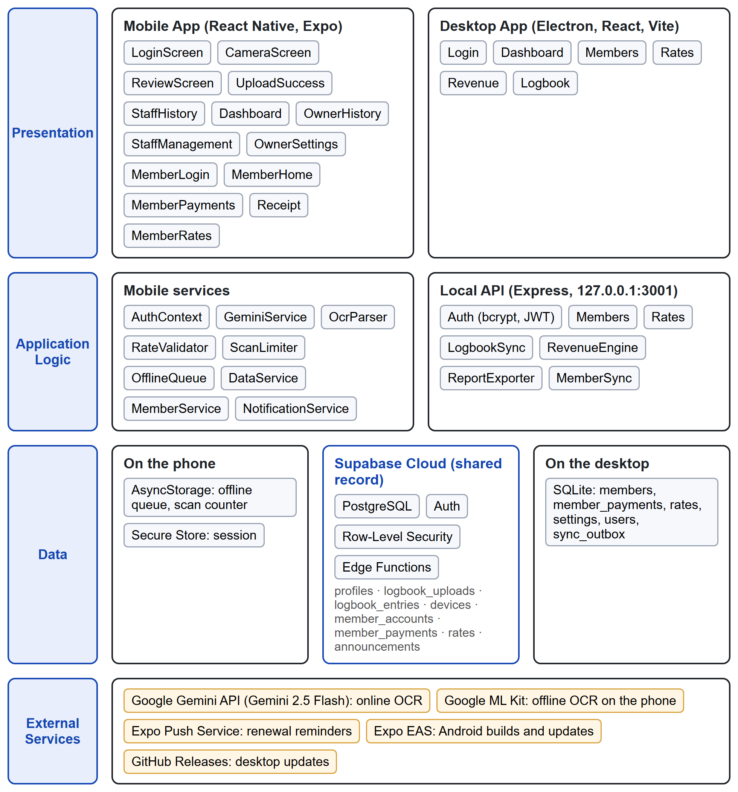

*Figure 1.0 Layered Architecture of the System*

The layers in the figure have the following responsibilities:

- **Presentation layer:** the screens of the mobile application, including the member screens, and the views of the desktop application. They show data, accept input and pass every request to the application logic layer; they never access a database directly.
- **Application logic layer:** the services of the mobile application (authentication, OCR, parsing, rate validation, scan limit, offline queue, data access, member data and notifications) and the local API of the desktop application (authentication, members, rates, logbook synchronization, revenue engine, report export and member data publishing).
- **Data layer:** the Supabase cloud database, which holds the profiles, uploads and entries shared by both applications and the copies of the records that invited members may see, with two Edge Functions that send the member invites and the daily reminders; the phone's local storage, which holds the offline queue, the scan counter and the session; and the desktop's SQLite database, which holds members, their payments, rates, settings, the desktop account and the outbox of changes to publish.
- **External services:** the Gemini API for online reading, ML Kit for offline reading on the phone, the Expo Push Service for renewal reminders, Expo EAS for Android builds and updates, and GitHub Releases for desktop updates.

### 2.1. Components and Deployment

The table below lists the deployable components of the system, the technology of each, and where it runs.

| Component | Technology | Runs On | Responsibility |
|---|---|---|---|
| Mobile application | React Native, Expo SDK, TypeScript | Android phones of the staff, the owner and members; members' web browsers | Capture, reading, review and upload of pages; owner monitoring; member screens |
| Online OCR | Google Gemini API, model Gemini 2.5 Flash, JSON output | Google Cloud | Reads a page image and returns entries |
| Offline OCR | Google ML Kit Text Recognition | The phone | Reads a page image without internet access |
| Cloud database | Supabase: PostgreSQL, Auth, Row-Level Security | Supabase Cloud | Shared record of profiles, uploads and entries; member copies; sign-in |
| Cloud functions | Supabase Edge Functions (TypeScript), pg_cron schedule | Supabase Cloud | member-access: invites and removes member accounts; send-reminders: daily renewal reminders |
| Push notifications | Expo Notifications, Expo Push Service | Expo cloud and members' phones | Delivers renewal reminders |
| Desktop application | Electron, React, Vite | Gym's Windows computer | Member, rate and logbook views; revenue analytics; member invites and announcements |
| Local API | Node.js, Express, JWT, bcrypt | Gym's Windows computer, 127.0.0.1:3001 | Business rules of the desktop application |
| Local database | SQLite (better-sqlite3) | Gym's Windows computer | Members, payments, rates, settings, desktop account, outbox, logbook backup |
| Report export | docx document library | Gym's Windows computer | Word revenue report |
| Update channels | Expo EAS; electron-updater with GitHub Releases | Cloud | Delivers new versions |

*Table 2.0 System Components*

### 2.2. Design Decisions

The following decisions shape the design. Each one answers a constraint or requirement in the SRS.

- **Two-tier OCR:** Gemini 2.5 Flash reads handwriting far better than on-device OCR, but it needs internet access and has a daily quota. The mobile application therefore tries Gemini first and falls back to ML Kit on the phone whenever Gemini is unavailable or the five daily scans are used up, so that scanning never stops.
- **Human confirmation:** OCR output is only a proposal. Every page passes through the Review screen, where amounts that are not official rates and repeated lines are flagged, and nothing is saved until a user confirms it.
- **Offline first:** a confirmed page is first saved directly to the cloud database; if the phone is offline or the save fails, the page goes into the offline queue on the phone and is uploaded later. A page is removed from the queue only after the upload succeeds.
- **Cloud as the shared record:** the logbook data lives in Supabase so that the owner's phone and the desktop application see the same uploads. The desktop keeps its own member and rate data in SQLite so that the gym's daily operations do not depend on the internet.
- **Reconciliation:** the same payment can appear both in the logbook and in a member payment recorded on the desktop. The revenue engine counts the logbook totals first and skips member payments that match a logbook entry by name, so each payment is counted once.
- **Member copies in the cloud:** the desktop remains the source of the member records and payments. It publishes to Supabase only the records of invited members, together with the rates and announcements, so that the member screens never reach the desktop database and only the data that members need is kept in the cloud. Changes made while the computer is offline wait in an outbox and are published when the connection returns.
- **Invite-only member access:** public sign-up is turned off in Supabase Auth. A member account exists only after the administrator sends an invite, members sign in with one-time email links instead of passwords, and Row-Level Security lets each member read only their own rows.
- **No online payment:** the member screens are read-only. Members pay and renew at the front desk, where the payment is recorded on the desktop and then appears in the member's history with a receipt.
- **Reminders from the cloud:** renewal reminders are sent by a scheduled Edge Function, not by the desktop, so that they go out every morning even when the gym's computer is turned off.
- **Security in depth:** access is checked in the interface (role-based navigation), in the local API (JWT on every request) and in the database (Row-Level Security), so a fault in one layer does not expose data.

### 2.3. Class Diagrams

The class diagrams below describe the structure of each part of the system. Because the applications are written in TypeScript and JavaScript with React, not every element is a class in the strict sense, so each box carries a stereotype: «screen» is a user interface screen or view, «module» is a service or group of functions, «type» is a data structure, «table» is a database table, and «external» is a library or service outside the system. A dashed arrow means “uses”, a solid arrow means navigation or a returned value, a line with a filled diamond means composition, and a plain line means association.

#### 2.3.1. Authentication and Access

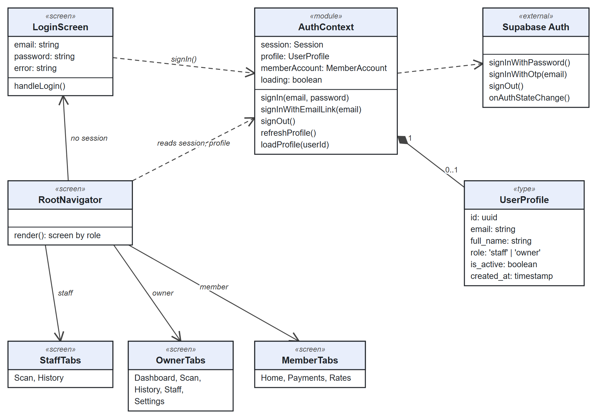

*Figure 2.0 Authentication and Access Class Diagram*

AuthContext holds the session and the profile of the signed-in user and offers signIn, signOut and refreshProfile to every screen. LoginScreen collects the email and password and calls signIn, which uses Supabase Auth to verify them. After sign-in, AuthContext loads the UserProfile from the profiles table and signs the user out again if the account is disabled (is_active is false). RootNavigator reads the session and the profile: without a session it shows LoginScreen; with one, it shows StaffTabs (Scan and History) for the staff or OwnerTabs (Dashboard, Scan, History, Staff and Settings) for the owner. A member signs in with signInWithEmailLink instead. Because a member's account has no profile, AuthContext loads the member's MemberAccount from the member_accounts table, and RootNavigator shows MemberTabs (Home, Payments and Rates).

#### 2.3.2. Logbook Capture and AI OCR

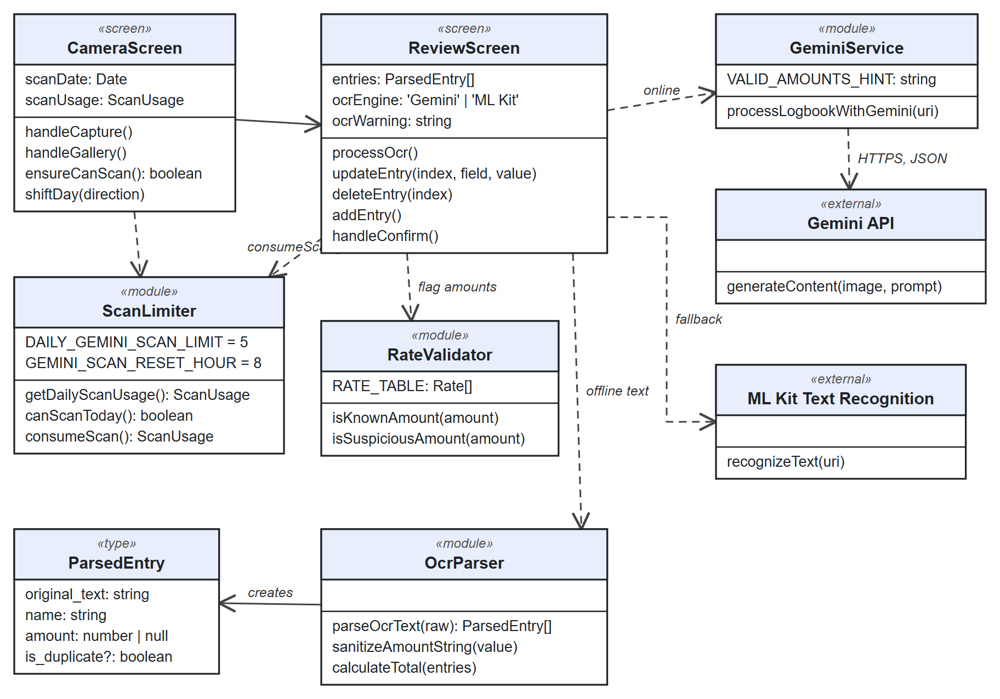

*Figure 3.0 Logbook Capture and AI OCR Class Diagram*

CameraScreen captures a page or imports it from the gallery, lets the user move the log date backward or forward, and asks ScanLimiter how many online scans remain (five per day, reset at 8:00 AM). ReviewScreen resizes the image and calls GeminiService, which sends it to the Gemini API with a prompt that lists NeoFit's valid amounts. If Gemini fails, times out or the daily limit is reached, ReviewScreen reads the page with ML Kit instead and passes the text to OcrParser, which cleans it into ParsedEntry rows. RateValidator flags every amount that is not an official rate. ReviewScreen owns the list of ParsedEntry rows that the user edits before confirming.

#### 2.3.3. Offline Queue and Synchronization

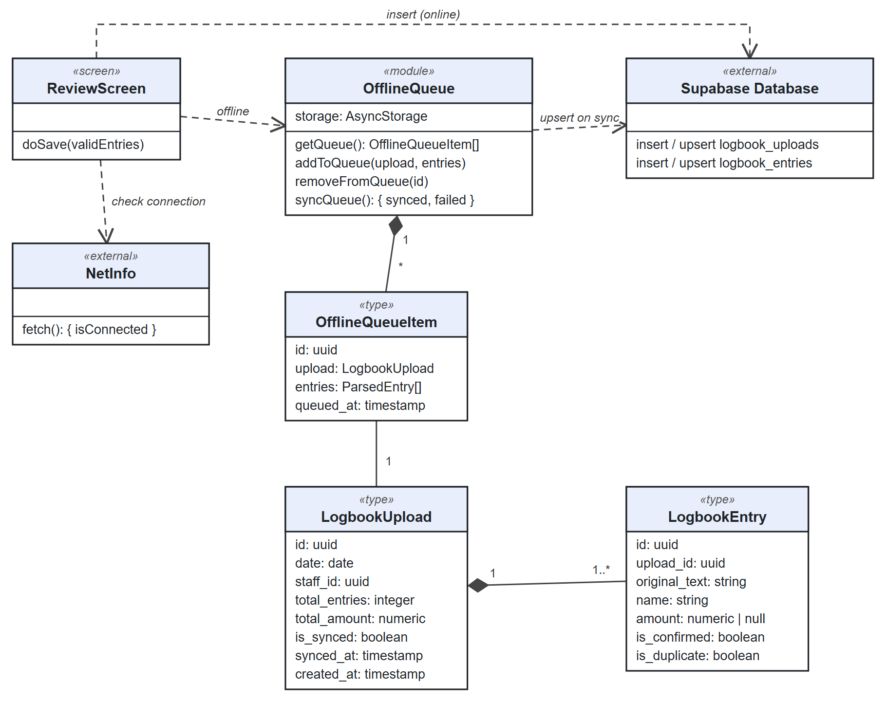

*Figure 4.0 Offline Queue and Synchronization Class Diagram*

When the user confirms a page, ReviewScreen checks the connection with NetInfo. If the phone is online, it inserts a LogbookUpload and its LogbookEntry rows into the Supabase database. If the phone is offline or the insert fails, it stores an OfflineQueueItem, which holds the upload and its entries, in the phone's AsyncStorage through OfflineQueue. OfflineQueue.syncQueue uploads the queued items with upsert operations, so that retrying an item never creates a duplicate, and removes each item only after its upload succeeds.

#### 2.3.4. Owner Monitoring

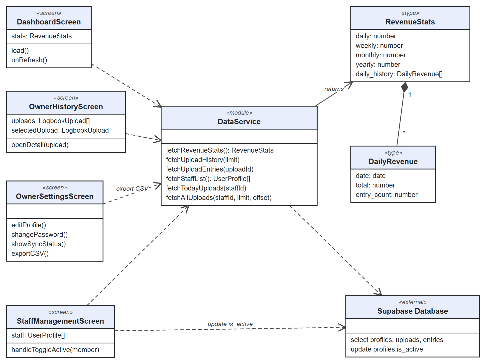

*Figure 5.0 Owner Monitoring Class Diagram*

The owner's screens read their data through DataService. DashboardScreen shows the RevenueStats for today, this week (from Monday), this month and this year, and a chart of the last seven days built from DailyRevenue items. OwnerHistoryScreen lists every upload with the staff member who scanned it and opens the entries of a selected upload. StaffManagementScreen lists the staff accounts and enables or disables them by updating is_active in the profiles table. OwnerSettingsScreen edits the owner's name and password, shows the sync status, and exports the latest uploads as a CSV file.

#### 2.3.5. Desktop Gym Management

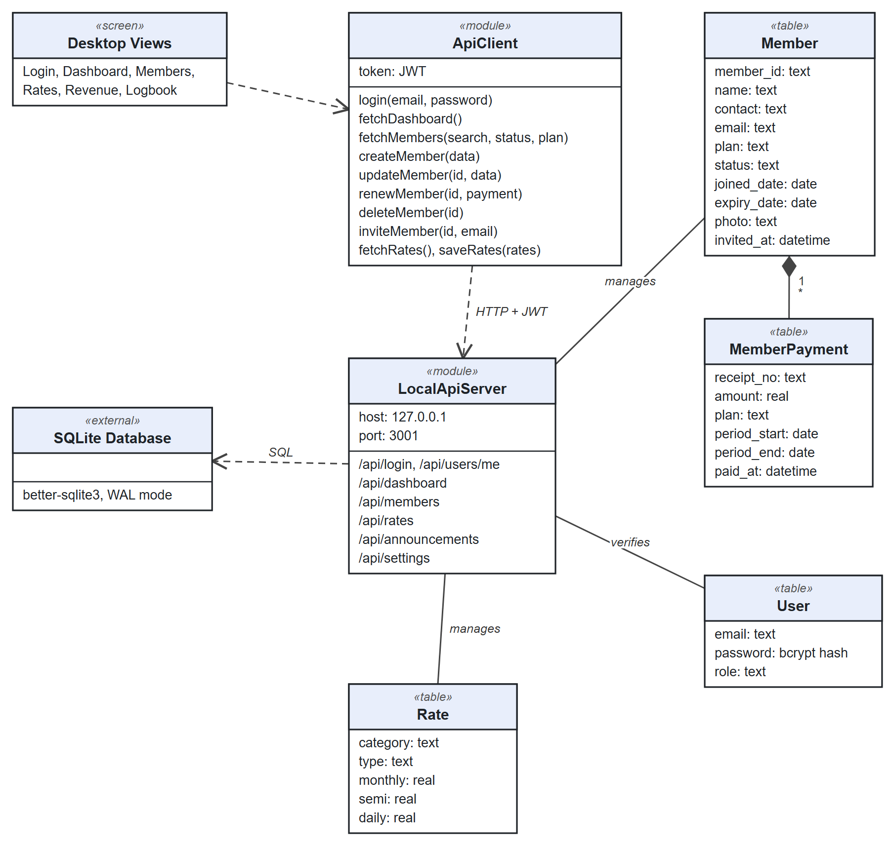

*Figure 6.0 Desktop Gym Management Class Diagram*

The views of the desktop application never touch the database. They call ApiClient, which sends HTTP requests with the administrator's JWT to LocalApiServer, an Express server that listens only on 127.0.0.1, port 3001. LocalApiServer applies the business rules and reads and writes the SQLite database: it manages the Member records and the MemberPayment records of each member, keeps the Rate table, and verifies the desktop User account whose password is stored as a bcrypt hash.

#### 2.3.6. Revenue Analytics

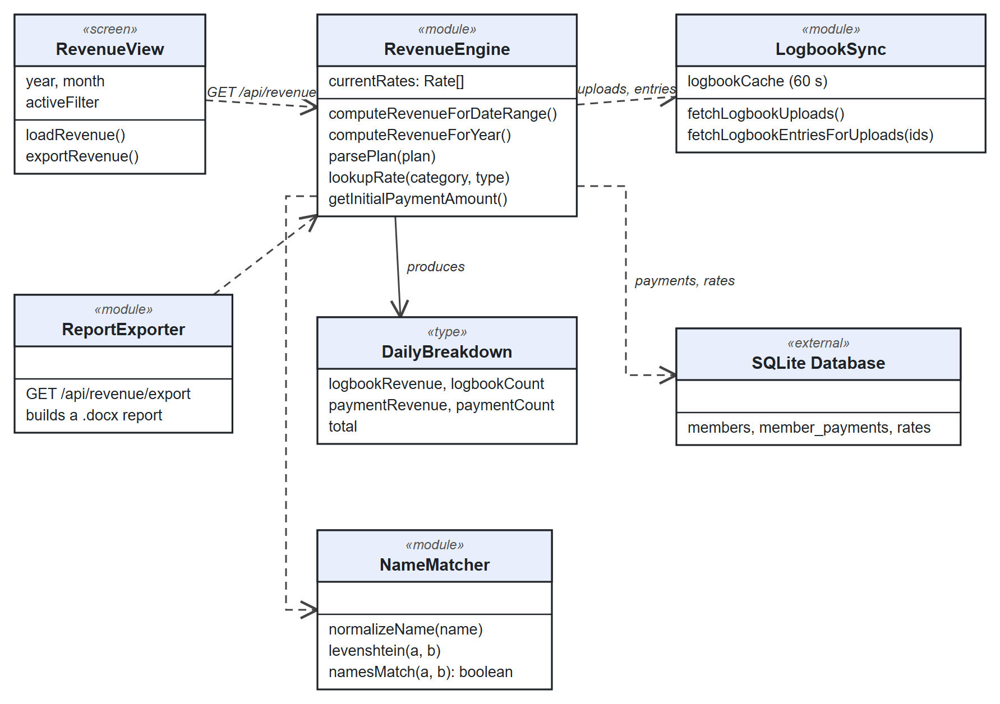

*Figure 7.0 Revenue Analytics Class Diagram*

RevenueEngine computes the revenue of a month or a year. It reads the members, their payments and the rates from SQLite, gets the logbook uploads and their entries through LogbookSync, and uses NameMatcher to decide whether a member payment is already recorded in the logbook. parsePlan splits a plan such as “Regular Plan - Monthly (No Treadmill)” into its category, period and treadmill option, and lookupRate finds its price. The result is a DailyBreakdown for every day of the period, which RevenueView charts and ReportExporter writes to a Word document.

#### 2.3.7. Logbook Synchronization

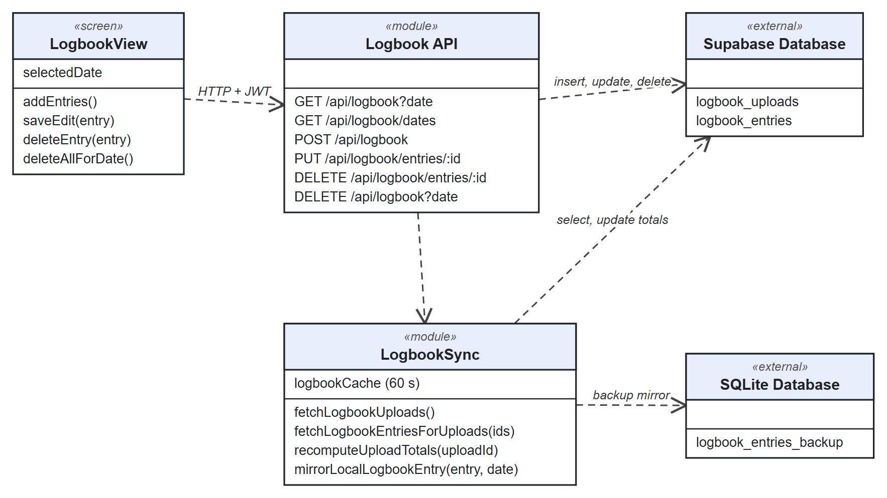

*Figure 8.0 Logbook Synchronization Class Diagram*

LogbookView reads and changes the synchronized logbook through the logbook routes of the local API. The routes insert, update and delete uploads and entries in the Supabase database, and they use LogbookSync for the shared work: reading the uploads with a 60-second cache, reading the entries of a set of uploads, recomputing the number of entries and the total of an upload after each change, and mirroring every added or edited entry into the logbook_entries_backup table in SQLite.

#### 2.3.8. Member Screens

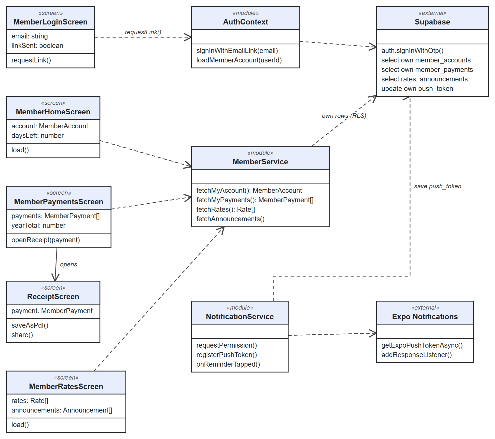

*Figure 9.0 Member Screens Class Diagram*

MemberLoginScreen asks AuthContext to email a sign-in link to the member's address. After sign-in, MemberTabs shows three tabs. MemberHomeScreen, MemberPaymentsScreen and MemberRatesScreen read their data through MemberService, which selects only the member's own rows; Row-Level Security in the database enforces the same limit. ReceiptScreen shows one MemberPayment, saves it as a PDF file with Expo Print and shares it with Expo Sharing. NotificationService asks for permission to show notifications after sign-in, gets the phone's push token from Expo Notifications and saves it in the member's row, and opens the Home screen when the member taps a reminder.

#### 2.3.9. Member Access on the Desktop and in the Cloud

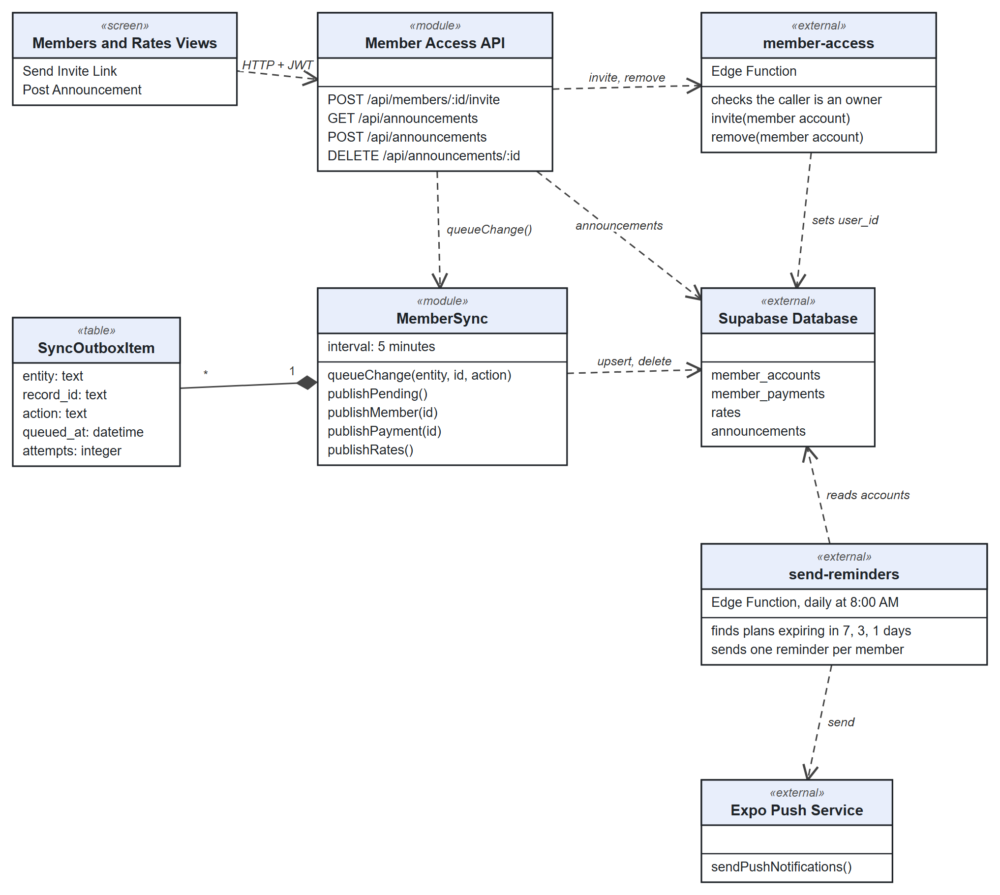

*Figure 10.0 Member Access Class Diagram*

The Members and Rates views call the member access routes of the local API. Sending an invite calls the member-access Edge Function, which runs inside Supabase, checks that the caller is an owner, and creates the member's sign-in account. Announcements are written to the cloud database directly, since only the member screens use them. Changes to members, payments and rates are not sent at once: the routes call MemberSync.queueChange, which adds a SyncOutboxItem to the outbox, and MemberSync.publishPending sends the pending items after every change and every five minutes, removing each one only after the cloud database has accepted it. The send-reminders Edge Function runs every morning, reads the member accounts and sends the reminders through the Expo Push Service.

## 3. Data Design

The system stores its data in three places. The Supabase cloud database is the shared record of profiles, logbook uploads and entries, used by both applications, and it holds the copies of the records that invited members may see: their accounts and payments, the rates and the announcements. The SQLite database on the gym's computer holds the data that the desktop application manages: members and their payments, rates, settings, the desktop account, the outbox of changes to publish and a backup of the logbook entries. The phone's local storage holds the offline queue, the daily scan counter and the signed-in session.

### 3.1. Data Description

The tables below describe each table of the two databases. For every field they give its name, its data type, its length and its purpose. The length is the maximum number of characters for text, the precision and scale for decimal numbers, and the storage size in bytes for other types. The databases store text without a fixed limit, so the lengths of text fields are the maximum values that the applications accept.

#### 3.1.1. Cloud Database

The cloud database runs on Supabase PostgreSQL. Its keys are UUIDs, its dates use the Philippine time zone, and every table has Row-Level Security enabled.

- **Table Name:** profiles
- **Description:** Holds one profile for every staff or owner account. A database trigger creates the profile when the owner adds a staff or owner account to Supabase Auth; accounts created by member invites get no profile.
- **Primary Key:** id
- **Foreign Key:** id references auth.users(id), deleted with the account

| Fieldname | Data Type | Length | Description |
|---|---|---|---|
| id | uuid | 36 | Identifier of the user; the same as the account's ID in auth.users. |
| email | text | 255 | Sign-in email address. Required. |
| full_name | text | 100 | Name shown in the application and on each upload. Required. |
| role | text | 5 | Role of the user: “staff” or “owner”. Checked by a constraint. |
| is_active | boolean | 1 | FALSE when the owner has disabled the account; a disabled account cannot sign in. Default TRUE. |
| created_at | timestamptz | 8 | Date and time the profile was created. Default: now. |

*Table 3.0 profiles Table*

- **Table Name:** logbook_uploads
- **Description:** Holds one row for every logbook page that a user confirmed, with the page's date and totals.
- **Primary Key:** id
- **Foreign Key:** staff_id references profiles(id)

| Fieldname | Data Type | Length | Description |
|---|---|---|---|
| id | uuid | 36 | Identifier of the upload, generated on the phone so that a queued page keeps the same ID. |
| date | date | 4 | Logbook date the page belongs to; may be earlier than the day of the scan. Required. |
| staff_id | uuid | 36 | The user who scanned and confirmed the page. Required. |
| image_url | text | 255 | Reserved for a stored copy of the page image. Not used in version 1.0, since page images are not kept. |
| total_entries | int | 4 | Number of entries saved from the page. Default 0. |
| total_amount | numeric | 10,2 | Sum of the amounts of the page, in pesos. Default 0. |
| is_synced | boolean | 1 | TRUE once the upload is stored in the cloud database. Default FALSE. |
| synced_at | timestamptz | 8 | Date and time the upload reached the cloud database. |
| created_at | timestamptz | 8 | Date and time the row was created. Default: now. |

*Table 4.0 logbook_uploads Table*

- **Table Name:** logbook_entries
- **Description:** Holds the lines of each confirmed page: a member name and the amount paid.
- **Primary Key:** id
- **Foreign Key:** upload_id references logbook_uploads(id), deleted with the upload

| Fieldname | Data Type | Length | Description |
|---|---|---|---|
| id | uuid | 36 | Identifier of the entry. |
| upload_id | uuid | 36 | The upload (page) the entry belongs to. Required. |
| original_text | text | 255 | The line as it was read by the OCR engine, kept for checking. Empty for entries added by hand on the desktop. |
| name | text | 100 | Member name, as confirmed by the user. Required. |
| amount | numeric | 10,2 | Amount paid, in pesos. Empty (NULL) when the line has no amount or the amount could not be read. |
| is_confirmed | boolean | 1 | TRUE when a user has confirmed the entry. Default TRUE. |
| is_duplicate | boolean | 1 | TRUE when the same name and amount appear more than once on the page. Default FALSE. |
| created_at | timestamptz | 8 | Date and time the row was created. Default: now. |

*Table 5.0 logbook_entries Table*

- **Table Name:** devices
- **Description:** Reserved for registering the phones that may use the system. Not used by the applications in version 1.0.
- **Primary Key:** id
- **Foreign Key:** owner_id references profiles(id)

| Fieldname | Data Type | Length | Description |
|---|---|---|---|
| id | uuid | 36 | Identifier of the device. |
| device_name | text | 100 | Name of the device. Required. |
| owner_id | uuid | 36 | The owner who registered the device. Required. |
| is_active | boolean | 1 | FALSE when the device is no longer allowed. Default TRUE. |
| registered_at | timestamptz | 8 | Date and time the device was registered. Default: now. |

*Table 6.0 devices Table*

- **Table Name:** member_accounts
- **Description:** Holds the cloud copy of every invited member: the membership shown in the member screens and the link to the member's sign-in account. The desktop publishes the rows; a member may read only their own row.
- **Primary Key:** id
- **Foreign Key:** user_id references auth.users(id)

| Fieldname | Data Type | Length | Description |
|---|---|---|---|
| id | uuid | 36 | Identifier of the member account; also kept in the desktop's members table (cloud_id). |
| member_id | text | 10 | Member ID from the desktop, in the form M-002. Unique. |
| user_id | uuid | 36 | The sign-in account created by the invite. Empty until the member is invited. |
| name | text | 100 | Full name of the member. Required. |
| email | text | 255 | Email address to which the invite and the sign-in links are sent. Unique and required. |
| plan | text | 60 | Current plan, in the same form as on the desktop. Required. |
| status | text | 15 | Active, Expiring Soon, Expired or Pending, as computed by the desktop. |
| joined_date | date | 4 | Start of the current plan. |
| expiry_date | date | 4 | End of the current plan; used for the days left and the reminders. |
| push_token | text | 255 | Expo push token of the member's phone. Empty when notifications are not allowed. The only field that a member may change. |
| last_reminder_on | date | 4 | Date the last renewal reminder was sent, so that no reminder is sent twice on one day. |
| invited_at | timestamptz | 8 | Date and time the invite was sent. |
| updated_at | timestamptz | 8 | Date and time the desktop last published the row. Default: now. |

*Table 7.0 member_accounts Table*

- **Table Name:** member_payments
- **Description:** Holds the cloud copy of the payments of invited members, shown in their payment history and receipts.
- **Primary Key:** id
- **Foreign Key:** account_id references member_accounts(id), deleted with the account

| Fieldname | Data Type | Length | Description |
|---|---|---|---|
| id | uuid | 36 | Identifier of the payment; the same as in the desktop's member_payments table, so that publishing it again never creates a duplicate. |
| account_id | uuid | 36 | The member account the payment belongs to. Required. |
| receipt_no | text | 12 | Receipt number in the form YYYY-MMDD-NN, for example 2026-0915-02. Unique. |
| amount | numeric | 10,2 | Amount paid, in pesos. Required. |
| plan | text | 60 | Plan the payment was for. Required. |
| period_start | date | 4 | First day covered by the payment. |
| period_end | date | 4 | Last day covered by the payment. |
| paid_at | timestamptz | 8 | Date and time the payment was recorded at the front desk. |

*Table 8.0 member_payments Table*

- **Table Name:** rates
- **Description:** Holds the cloud copy of NeoFit's official rate table, shown in the member screens. The desktop publishes it after every change.
- **Primary Key:** category and type
- **Foreign Key:** None

| Fieldname | Data Type | Length | Description |
|---|---|---|---|
| category | text | 20 | “Regular Plan” or “Student/Senior Plan”. |
| type | text | 15 | “No Treadmill” or “With Treadmill”. |
| monthly | numeric | 10,2 | Price of one month, in pesos. |
| semi | numeric | 10,2 | Price of half a month, in pesos. |
| daily | numeric | 10,2 | Price of one day, in pesos. |
| updated_at | timestamptz | 8 | Date and time the rates were last published. |

*Table 9.0 rates Table*

- **Table Name:** announcements
- **Description:** Holds the announcements that the administrator posts for the members.
- **Primary Key:** id
- **Foreign Key:** None

| Fieldname | Data Type | Length | Description |
|---|---|---|---|
| id | uuid | 36 | Identifier of the announcement. |
| title | text | 80 | Short title, such as “Holiday hours on Nov 1–2”. Required. |
| body | text | 500 | Message of the announcement. Required. |
| posted_at | timestamptz | 8 | Date and time the announcement was posted. Default: now. |

*Table 10.0 announcements Table*

Row-Level Security decides which rows each signed-in user may read or change, whatever application sends the request. The desktop application's local API signs in to Supabase with the owner's account, whose credentials are kept in a configuration file outside the source code. The Edge Functions run inside Supabase with the service role, whose key never leaves the cloud. Public sign-up is turned off in Supabase Auth, so accounts exist only for the staff and the owner, added by the owner, and for invited members. In the policies below, “staff or owner” means a user with an active profile and “owner” a user whose active profile has the owner role. A member has no profile, so a member can never read the profiles, the uploads or the logbook entries.

| Table | Operation | Allowed When |
|---|---|---|
| profiles | Select | The user is staff or owner. |
| profiles | Update | The profile is the user's own, or the user is an owner (to enable or disable staff accounts). |
| logbook_uploads | Select | The user is staff or owner. |
| logbook_uploads | Insert, Update | The upload's staff_id is the signed-in user. |
| logbook_uploads | Delete | The upload's staff_id is the signed-in user, or the user is an owner. |
| logbook_entries | Select | The user is staff or owner. |
| logbook_entries | Insert | The entry belongs to an upload of the signed-in user. |
| logbook_entries | Update, Delete | The entry belongs to an upload of the signed-in user, or the user is an owner. |
| devices | Select | The user is staff or owner. |
| devices | Insert, Update | The device's owner_id is the signed-in user. |
| member_accounts | Select | The row's user_id is the signed-in user, or the user is an owner. |
| member_accounts | Update | The user is an owner; a member may change only push_token in their own row (column privilege). |
| member_accounts | Insert, Delete | The user is an owner. |
| member_payments | Select | The payment belongs to the signed-in member's account, or the user is an owner. |
| member_payments | Insert, Update, Delete | The user is an owner. |
| rates, announcements | Select | Any signed-in user. |
| rates, announcements | Insert, Update, Delete | The user is an owner. |

*Table 11.0 Row-Level Security Policies*

#### 3.1.2. Desktop Database

The desktop database is a single SQLite file on the gym's computer. SQLite stores dates as text in the form YYYY-MM-DD and date-times as YYYY-MM-DD HH:MM:SS, and the local API keeps the member status up to date whenever members are listed.

- **Table Name:** members
- **Description:** Holds the gym's members and their current plans.
- **Primary Key:** id
- **Foreign Key:** None

| Fieldname | Data Type | Length | Description |
|---|---|---|---|
| id | INTEGER | 8 | Internal identifier, assigned automatically. |
| member_id | TEXT | 10 | Member ID shown to the staff, in the form M-001. Unique; the next free number is assigned automatically. |
| name | TEXT | 100 | Full name of the member. Required. |
| contact | TEXT | 20 | Mobile number of the member. Required. |
| email | TEXT | 255 | Email address for the member screens. Optional; required before an invite. |
| plan | TEXT | 60 | Plan in the form “Regular Plan - Monthly (No Treadmill)”: category, period and treadmill option. Required. |
| status | TEXT | 15 | Active, Expiring Soon, Expired or Pending, computed from the dates. Default Active. |
| joined_date | DATE | 10 | Start of the current plan. |
| expiry_date | DATE | 10 | End of the current plan. |
| address | TEXT | 150 | Address of the member. Default empty. |
| photo | TEXT | 2 MB | Photo of the member, stored as a base64 image. |
| cloud_id | TEXT | 36 | ID of the member's row in the cloud member_accounts table. Empty until the member is invited. |
| invited_at | DATETIME | 19 | Date and time the invite was sent. Empty when the member has not been invited. |
| created_at | DATETIME | 19 | Date and time the member was added. Default: now. |
| updated_at | DATETIME | 19 | Date and time the member was last changed. Default: now. |

*Table 12.0 members Table*

- **Table Name:** member_payments
- **Description:** Holds every payment of every member: the first payment and each renewal. The revenue engine counts each payment on its payment date.
- **Primary Key:** id
- **Foreign Key:** member_id references members(id)

| Fieldname | Data Type | Length | Description |
|---|---|---|---|
| id | TEXT | 36 | UUID of the payment, generated on the desktop and kept in the cloud copy. |
| member_id | INTEGER | 8 | The member who paid. Required. |
| receipt_no | TEXT | 12 | Receipt number in the form YYYY-MMDD-NN, where NN counts the payments recorded that day. Unique. |
| amount | REAL | 8 | Amount actually paid, in pesos; filled in from the rate of the plan and changed when the member pays a different amount. Required. |
| plan | TEXT | 60 | Plan the payment was for. Required. |
| period_start | DATE | 10 | First day covered by the payment. |
| period_end | DATE | 10 | Last day covered by the payment. |
| paid_at | DATETIME | 19 | Date and time the payment was recorded; the payment is counted as revenue on this date. Default: now. |

*Table 13.0 member_payments Table*

- **Table Name:** rates
- **Description:** Holds NeoFit's official rate table, which the revenue engine and the member forms use.
- **Primary Key:** id
- **Foreign Key:** None (category and type together are unique)

| Fieldname | Data Type | Length | Description |
|---|---|---|---|
| id | INTEGER | 8 | Identifier of the rate, assigned automatically. |
| category | TEXT | 20 | “Regular Plan” or “Student/Senior Plan”. Required. |
| type | TEXT | 15 | “No Treadmill” or “With Treadmill”. Required. |
| monthly | REAL | 8 | Price of one month, in pesos. Default 0. |
| semi | REAL | 8 | Price of half a month, in pesos. Default 0. |
| daily | REAL | 8 | Price of one day, in pesos. Default 0. |

*Table 14.0 rates Table*

- **Table Name:** users
- **Description:** Holds the desktop application's account, used to sign in to the local API.
- **Primary Key:** id
- **Foreign Key:** None

| Fieldname | Data Type | Length | Description |
|---|---|---|---|
| id | INTEGER | 8 | Identifier of the account, assigned automatically. |
| email | TEXT | 255 | Sign-in email address. Unique and required. |
| password | TEXT | 60 | bcrypt hash of the password; the password itself is never stored. Required. |
| role | TEXT | 10 | Role of the account; “admin” for the administrator. Required. |
| created_at | DATETIME | 19 | Date and time the account was created. Default: now. |

*Table 15.0 users Table*

- **Table Name:** settings
- **Description:** Holds the gym's details in a single row.
- **Primary Key:** id (always 1)
- **Foreign Key:** None

| Fieldname | Data Type | Length | Description |
|---|---|---|---|
| id | INTEGER | 8 | Always 1, so that the table has one row. |
| gym_name | TEXT | 100 | Name of the gym. Default “NeoFit Fitness Gym”. |
| contact | TEXT | 50 | Contact number of the gym. |
| address | TEXT | 150 | Address of the gym. |

*Table 16.0 settings Table*

- **Table Name:** logbook_entries_backup
- **Description:** Holds a local copy of every logbook entry that the desktop application adds or edits, so that entries can be recovered if the cloud data is lost.
- **Primary Key:** id
- **Foreign Key:** None (id and upload_id copy the cloud IDs)

| Fieldname | Data Type | Length | Description |
|---|---|---|---|
| id | TEXT | 36 | ID of the entry in the cloud logbook_entries table. |
| date | TEXT | 10 | Logbook date of the entry. Required. |
| name | TEXT | 100 | Member name. Required. |
| amount | REAL | 8 | Amount paid, in pesos. Default 0. |
| upload_id | TEXT | 36 | ID of the upload the entry belongs to. |
| created_at | TEXT | 25 | Date and time the entry was created in the cloud. |

*Table 17.0 logbook_entries_backup Table*

- **Table Name:** sync_outbox
- **Description:** Lists the changes to members, payments and rates that still have to be published to the cloud database.
- **Primary Key:** id
- **Foreign Key:** None

| Fieldname | Data Type | Length | Description |
|---|---|---|---|
| id | INTEGER | 8 | Identifier of the item, assigned automatically. |
| entity | TEXT | 10 | Kind of record: “member”, “payment” or “rates”. Required. |
| record_id | TEXT | 36 | ID of the changed record; empty for the rates, which are published as a whole. |
| action | TEXT | 6 | “upsert” to add or update the cloud copy, “delete” to remove it. Required. |
| queued_at | DATETIME | 19 | Date and time the change was queued. Default: now. |
| attempts | INTEGER | 8 | Number of failed attempts to publish the change. Default 0. |

*Table 18.0 sync_outbox Table*

#### 3.1.3. Mobile Local Storage

The mobile application keeps three records on the phone. They hold no member data beyond the entries of pages that are waiting to be uploaded.

| Record | Stored In | Contents | Removed When |
|---|---|---|---|
| Offline queue | AsyncStorage | A list of queued pages. Each item has an ID, the upload (date, staff, totals), its entries (name, amount, original text, duplicate flag) and the time it was queued. | The page is uploaded successfully. |
| Scan counter | AsyncStorage | The number of Gemini scans used and the start of the current scan day (8:00 AM). | Reset at 8:00 AM each day. |
| Session | Secure Store | The Supabase session of the signed-in user, so that the user stays signed in. | The user signs out, or the session expires. |

*Table 19.0 Mobile Local Storage*

### 3.2. Entity-Relationship Diagram

The diagrams below use crow's foot notation: two bars mean “exactly one”, a crow's foot with a bar means “one or more”, and a crow's foot with a circle means “zero or more”.

#### 3.2.1. Cloud Database

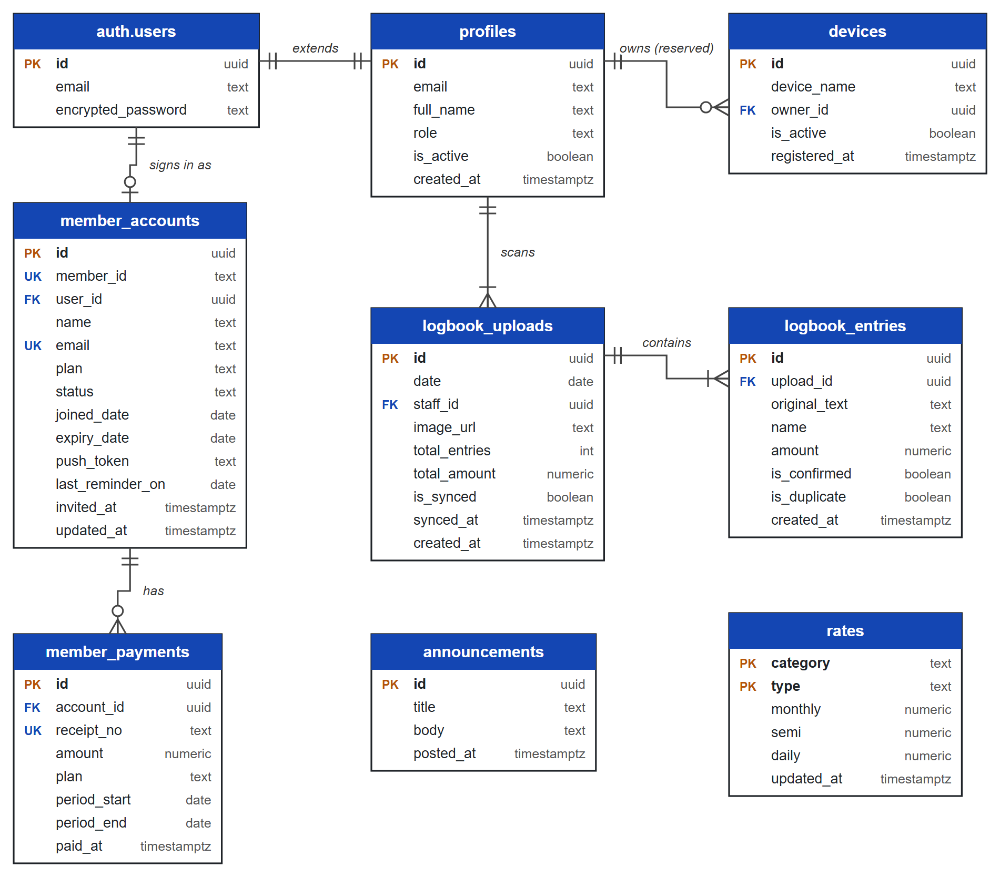

*Figure 11.0 Cloud Database Entity-Relationship Diagram*

Every account in Supabase Auth has exactly one profile, which extends it with a name, a role and an active flag. A profile can scan many logbook uploads, and each upload belongs to the one profile that scanned it. An upload contains one or more entries, and deleting an upload deletes its entries. A profile may also own devices, a table that is reserved for a later version. An account in Supabase Auth can also belong to at most one member account, linked when the member is invited, and a member account has zero or more payments, which are deleted with it. The rates and announcements tables stand alone.

#### 3.2.2. Desktop Database

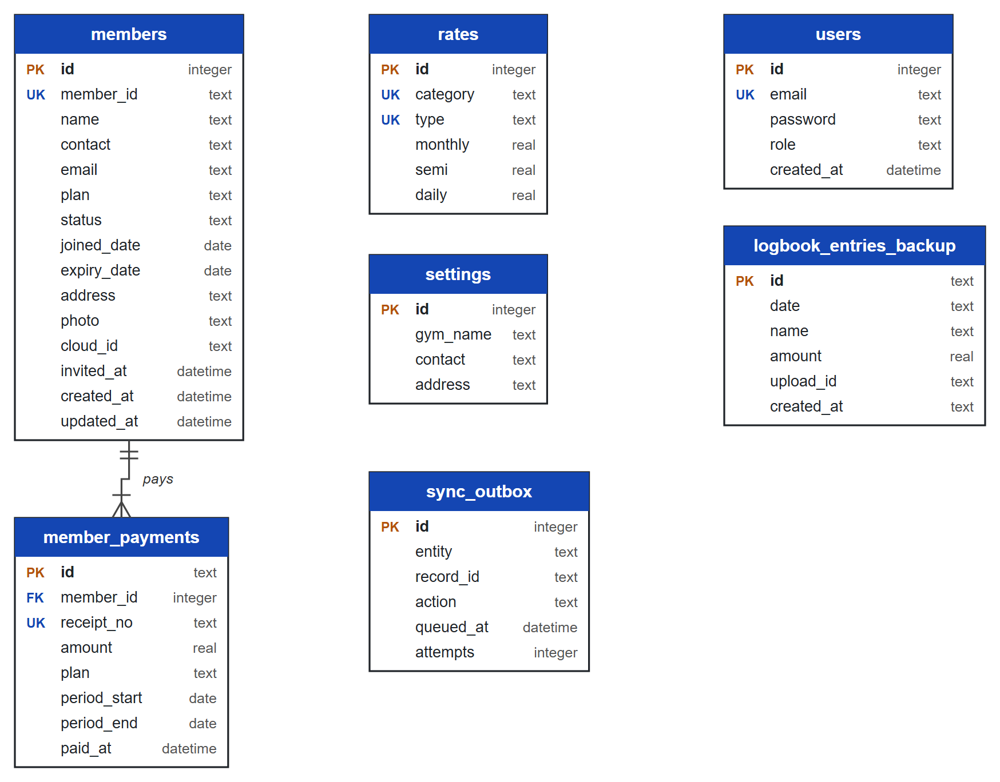

*Figure 12.0 Desktop Database Entity-Relationship Diagram*

Each member has one or more payments in the member_payments table, starting with the payment made when the member joined. The rates, users, settings and sync_outbox tables stand alone: the rate of a plan is found by matching its category and treadmill option to a row of the rates table, not through a foreign key, and an outbox item refers to its record by ID only. The logbook_entries_backup table mirrors entries of the cloud database and keeps their cloud IDs.

## 4. Detailed Design

This section describes how the components work together to carry out the main functions of the system. Sequence diagrams show the messages exchanged, in time order, for the functions with the most interaction; the rules that the functions apply are given in tables. The table below traces each functional requirement of the SRS to its design.

| Req. | Use Case | Design Elements | Detailed Design |
|---|---|---|---|
| FR-01 | User Authentication and Role-Based Access | LoginScreen, AuthContext, RootNavigator, desktop Login view, users table | Section 4.1 |
| FR-02 | Logbook Page Capture | CameraScreen, ScanLimiter | Section 4.2 |
| FR-03 | Hybrid AI OCR Extraction | ReviewScreen, GeminiService, ML Kit, OcrParser | Sections 4.2 and 4.3 |
| FR-04 | Entry Validation and Review | ReviewScreen, RateValidator | Section 4.4 |
| FR-05 | Offline Queue and Synchronization | ReviewScreen, OfflineQueue, StaffHistoryScreen | Section 4.5 |
| FR-06 | Owner Revenue Monitoring | DashboardScreen, OwnerHistoryScreen, OwnerSettingsScreen, DataService | Section 4.6 |
| FR-07 | Staff Account Management | StaffManagementScreen, profiles table | Section 4.6 |
| FR-08 | Member Management | Members view, LocalApiServer, MemberSync, members and member_payments tables | Sections 4.7 and 4.11 |
| FR-09 | Rates and Announcements Management | Rates view, MemberSync, rates and announcements tables | Section 4.8 |
| FR-10 | Logbook Management | LogbookView, Logbook API, LogbookSync | Section 4.9 |
| FR-11 | Revenue Analytics and Reports | RevenueView, RevenueEngine, NameMatcher, ReportExporter | Section 4.10 |
| FR-12 | Member Sign-In and Membership Status | MemberLoginScreen, AuthContext, MemberHomeScreen, MemberRatesScreen, MemberService, member-access function | Sections 4.1, 4.11 and 4.12 |
| FR-13 | Member Payment History and Receipts | MemberPaymentsScreen, ReceiptScreen, MemberService, member_payments table | Section 4.12 |
| FR-14 | Membership Renewal Reminders | NotificationService, send-reminders function, Expo Push Service | Section 4.13 |

*Table 20.0 Requirements Traceability*

### 4.1. Sign In and Role-Based Access

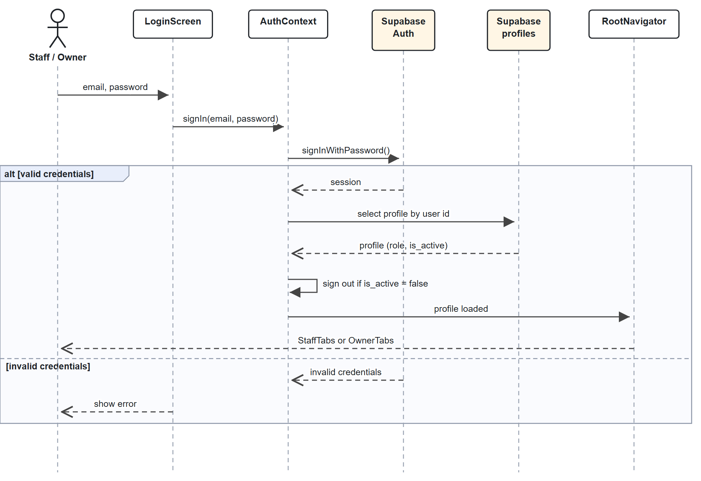

*Figure 13.0 Sign In Sequence Diagram*

A user signs in to the mobile application as follows:

1. The user enters an email and a password on LoginScreen, which calls AuthContext.signIn.
2. AuthContext asks Supabase Auth to verify the credentials. If they are wrong, LoginScreen shows an error and the user stays on the screen.
3. With a valid session, AuthContext loads the user's profile from the profiles table.
4. If the profile's is_active flag is false, AuthContext signs the user out at once and LoginScreen explains that the account has been disabled.
5. Otherwise RootNavigator shows the tabs of the user's role: StaffTabs for the staff, OwnerTabs for the owner. The session is kept in Secure Store, so the user stays signed in until signing out.

The desktop application follows the same pattern with its own account. Its Login view sends the email and password to POST /api/login; the local API compares the password with the bcrypt hash in the users table and returns a JWT that expires after 24 hours. ApiClient keeps the token in memory and sends it with every request; when a request is refused because the token is missing or expired, the application returns to the Login view.

A member signs in without a password. MemberLoginScreen calls AuthContext.signInWithEmailLink, which asks Supabase Auth to email a one-time link with new accounts disabled, so that only invited addresses receive one. When the member opens the link, AuthContext receives the session. The account has no profile, so AuthContext loads the member's row from member_accounts instead, and RootNavigator shows MemberTabs. An account that has neither a profile nor a member account is signed out at once.

### 4.2. Online Logbook Reading

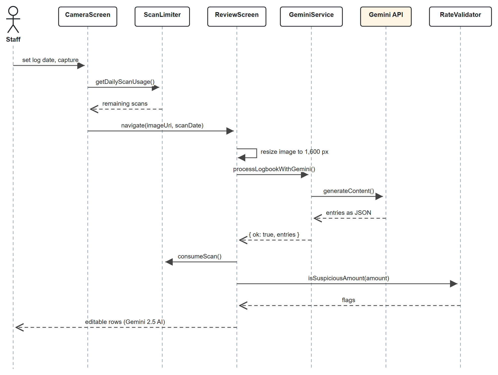

*Figure 14.0 Online Logbook Reading Sequence Diagram*

The staff member sets the log date on CameraScreen, which also shows the number of Gemini scans left, and captures the page. ReviewScreen resizes the image to a width of 1,600 pixels and compresses it, then calls GeminiService. GeminiService sends the image to Gemini 2.5 Flash with a prompt that describes the logbook layout and lists NeoFit's valid amounts, asking for a JSON list of entries with a low temperature (0.1) so that the model does not invent values. When the entries arrive, ReviewScreen uses up one scan from ScanLimiter, asks RateValidator to flag unusual amounts, and shows the rows for review with the label “Gemini 2.5 AI”.

### 4.3. Offline Logbook Reading

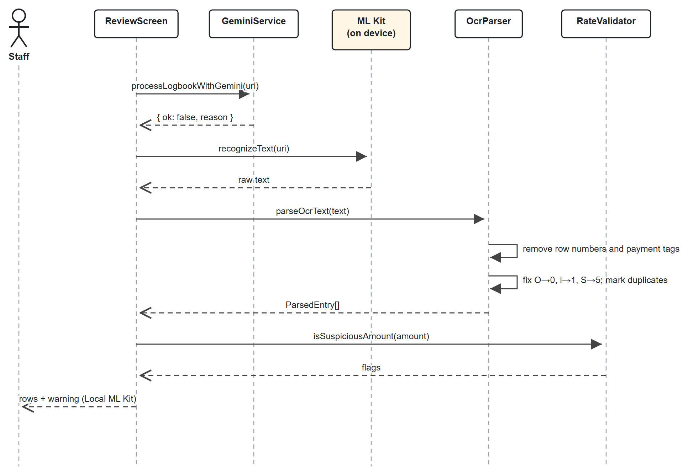

*Figure 15.0 Offline Logbook Reading Sequence Diagram*

When GeminiService reports a failure (no connection, an API error, a time-out or no scans left), ReviewScreen reads the page with ML Kit on the phone and passes the raw text to OcrParser. The screen shows a warning that the local results may be less accurate and labels the rows “Local ML Kit”. OcrParser turns each line of text into an entry with the rules below.

| No. | Rule | Example |
|---|---|---|
| 1 | Remove the row number or bullet at the start of the line. | “3. AJ – 60” becomes “AJ – 60” |
| 2 | Remove the payment method written after the amount: G-Cash, GCash, GC or Cash. | “Ian – 450 – G-Cash” becomes “Ian – 450” |
| 3 | Split the line into a name and the number at its end. | “Ian – 450” gives name “Ian”, amount 450 |
| 4 | Remove the peso sign (written as P or Php) and punctuation from the amount. | “P450.” becomes “450” |
| 5 | Replace letters that OCR confuses with digits: O, Q, D → 0; I, l, | → 1; S → 5; B → 8; Z → 2. | “1S0” becomes “150” |
| 6 | Leave the amount empty when no number can be read, instead of guessing. | “Janice” gives an empty amount |
| 7 | Mark lines with the same name and amount as possible duplicates. | Two lines “Rose – 90” are both marked |

*Table 21.0 OCR Text Cleanup Rules*

### 4.4. Entry Validation and Review

ReviewScreen shows the page image above an editable table of entries, and the total of the page at the bottom. Each row can be edited, deleted or added by hand. Two kinds of flags help the user find mistakes before confirming:

- **Unusual amount:** RateValidator marks an amount with “amount?” when it is not one of the official rates in the table below, for example 75 when the daily rates are 60, 70, 80 and 90.
- **Possible duplicate:** a row is marked “DUP” when the same name and amount appear more than once on the page.

| Plan Category | Option | Monthly (PHP) | Semi-Monthly (PHP) | Daily (PHP) |
|---|---|---|---|---|
| Regular Plan | No Treadmill | 700 | 350 | 70 |
| Regular Plan | With Treadmill | 900 | 450 | 90 |
| Student/Senior Plan | No Treadmill | 600 | 300 | 60 |
| Student/Senior Plan | With Treadmill | 800 | 400 | 80 |

*Table 22.0 Official NeoFit Rate Table*

Flags never block saving: a flagged value may be correct, for example a discounted payment. When the user taps Confirm & Save, rows without a name are ignored, at least one named row is required, and the application asks the user to confirm the number of entries, the log date and the total before the page is saved.

### 4.5. Saving, Offline Queue and Synchronization

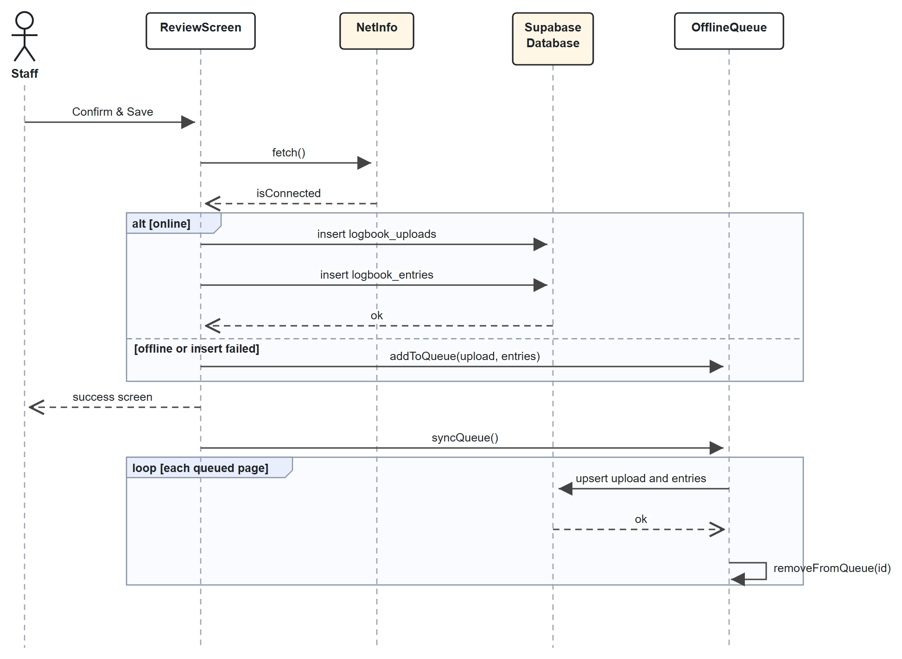

*Figure 16.0 Save and Synchronization Sequence Diagram*

Saving a confirmed page follows these steps:

1. ReviewScreen creates the upload with a new UUID, the log date, the user's ID, the number of entries and the total, and checks the connection with NetInfo.
2. If the phone is online, it inserts the upload and then its entries into the cloud database, with is_synced set to true.
3. If the phone is offline, or either insert fails, it adds the upload and its entries to the offline queue instead. The page is never lost, because the queue item is removed only after a successful upload.
4. The Upload Success screen shows the date, the number of entries, the total and the time, whichever path was taken.
5. OfflineQueue.syncQueue then uploads every queued page with upsert operations, so that a page uploaded twice does not create duplicate rows. Synchronization also runs when the staff open or refresh the History screen, where queued pages are labelled “Pending Sync” and uploaded pages “Synced”.

### 4.6. Owner Monitoring and Staff Accounts

The owner's Dashboard computes four totals from the total_amount of the uploads in the cloud database: today, this week from Monday, this month from the first day, and this year from January 1. It also shows the daily totals of the last seven days in a chart and a summary of today. The Revenue History screen lists all uploads, newest first, with the date, the staff member, the number of entries and the total; tapping an upload opens its entries. The Settings screen exports the latest 100 uploads as a CSV file that can be opened in a spreadsheet.

The Staff Management screen lists the staff accounts with the number of active and disabled accounts. Disabling an account sets is_active to false in the profiles table, which Row-Level Security allows only for an owner; the staff member can no longer sign in, but the uploads made with the account remain. Enabling the account sets the flag back to true. Accounts themselves are created by the owner in Supabase Auth, and a database trigger creates the matching profile.

### 4.7. Member Management

On the Members view, the administrator adds, edits, renews, views and deletes members. New members receive the next free member ID (M-001, M-002 and so on). Every payment, the first one and each renewal, is saved as a row of the member_payments table with the amount, the plan, the period it covers and a receipt number in the form YYYY-MMDD-NN, where NN counts the payments recorded that day (for example 2026-0915-02). The amount is filled in from the rate of the selected plan and can be changed when the member pays a different amount; the payment is counted as revenue on its payment date. A renewal starts the new period on the day after the current one ends, so paid days are kept. The member's status is computed from the plan dates with the rules below, and it is updated whenever members are listed.

| Status | Condition |
|---|---|
| Pending | The joined date is later than today: the plan has not started. |
| Expired | The expiry date is earlier than today. |
| Expiring Soon | The expiry date is today or within the next seven days. |
| Active | Any other case. |

*Table 23.0 Member Status Rules*

The desktop Dashboard summarizes the active members, today's logbook entries and revenue, and lists the members whose plans have expired or will expire soon, so that the staff can remind them to renew.

The Member Details window also shows the member's access to the member screens, “Not invited yet” or “Invited”, with the email address and the Send Invite Link button described in Section 4.11. Deleting a member who has been invited also removes the member's cloud copy and sign-in account.

### 4.8. Rates and Announcements Management

The Rates view shows the four rows of the rate table with their monthly, semi-monthly and daily prices as editable fields. Save Rates writes the changes to the rates table, and Reset Default restores the official rates in Table 22.0. The revenue engine reloads the rates after every change, so revenue computations, the revenue report and the automatic amount in the member forms always use the current prices. The mobile application checks amounts against the same official rates. Saving the rates also queues them in the outbox, so that the rates in the member screens follow the desktop.

Below the rate table, the administrator posts announcements for members with a title and a message, and removes old ones. The local API writes them directly to the announcements table in the cloud database, so posting requires an internet connection. The member screens show the announcements newest first.

### 4.9. Logbook Management

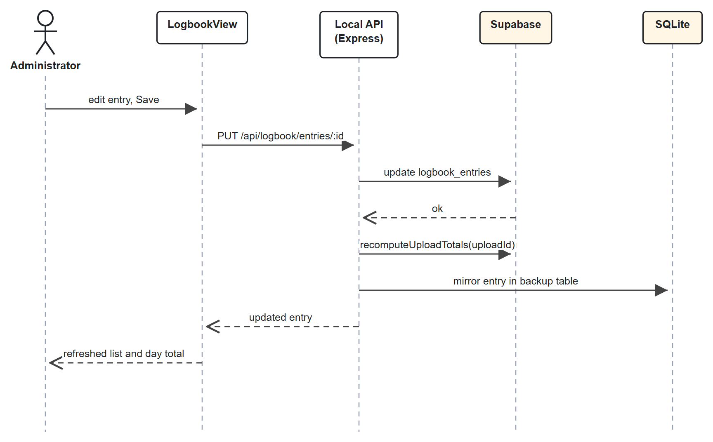

*Figure 17.0 Logbook Entry Correction Sequence Diagram*

The Logbook view lists the synchronized entries of a selected date, with a calendar that shows the total of every day that has entries. When the administrator corrects an entry, the local API updates it in the cloud database, recomputes the number of entries and the total of its upload, mirrors the entry into the local backup table, and clears the logbook cache so that the revenue views show the new values. Adding entries by hand creates a new upload for the date; deleting an entry recomputes the totals of its upload, and an upload left without entries is deleted.

### 4.10. Revenue Analytics and Reports

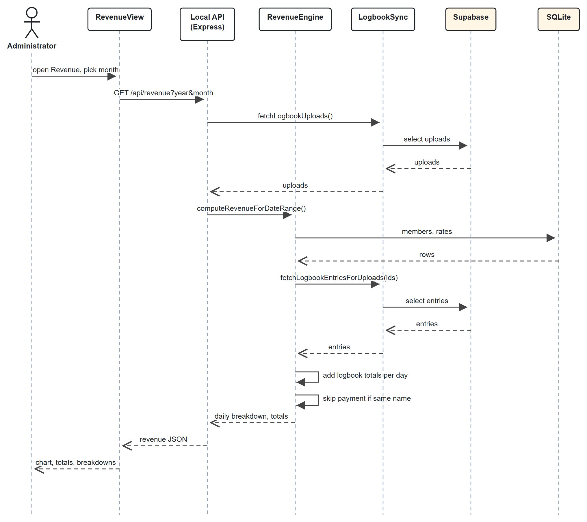

*Figure 18.0 Revenue Reconciliation Sequence Diagram*

When the administrator opens the Revenue view and chooses a month, the local API gets the logbook uploads through LogbookSync, which queries Supabase only when its cached copy is older than 60 seconds, and passes them to RevenueEngine. RevenueEngine reads the members, their payments and the rates from SQLite and the entries of the month's uploads from Supabase, then builds a daily breakdown with the rules below.

| Source | Counted | Skipped When |
|---|---|---|
| Logbook uploads | The total amount of every upload, on the upload's date. | Never; the logbook is the primary record. |
| Member payments | The amount of every payment in the member_payments table, on its payment date. | A logbook entry on the same date has the member's name. |

*Table 24.0 Revenue Reconciliation Rules*

Two names match when they are equal after removing extra spaces and ignoring case, when one contains the other, or when their Levenshtein distance, the number of single-letter changes needed to turn one into the other, is at most 2 or 30% of the length of the longer name. This tolerates the small differences between a handwritten name and the name in the member records, such as “Rose” and “Rose Garcia”.

The result gives, for each day, the revenue and count from the logbook and from payments, and their total; the month's revenue by plan; and the comparison with the previous period. RevenueView shows them as a chart and breakdowns, and Download Report asks ReportExporter to produce the same figures as a Word document. A yearly view adds up the twelve months in the same way.

### 4.11. Member Invitations and Data Publishing

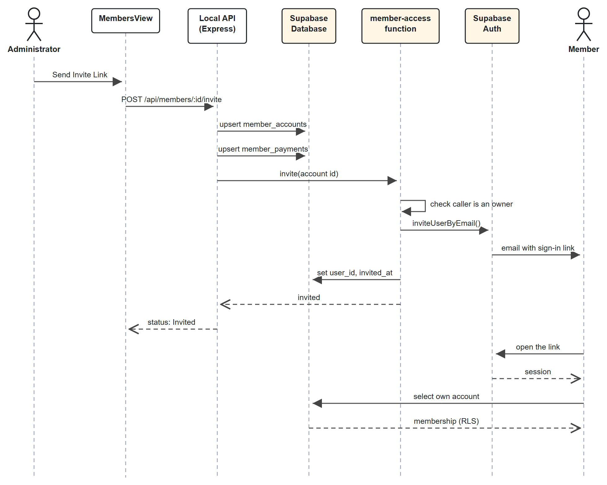

*Figure 19.0 Member Invitation Sequence Diagram*

The administrator invites a member from the Member Details window as follows:

1. The administrator enters or confirms the member's email address and taps Send Invite Link. MembersView sends POST /api/members/:id/invite to the local API.
2. The local API saves the email address and publishes the member at once: it upserts the member's row in member_accounts and the member's payments in member_payments, and stores the new cloud ID in the members table.
3. The local API then calls the member-access Edge Function with the owner's session. The function checks that the caller is an owner and asks Supabase Auth to invite the email address, which creates the member's sign-in account and emails a sign-in link.
4. The function stores the new account's ID in user_id and the time in invited_at, and the Member Details window shows the status “Invited”.
5. When the member opens the link, Supabase Auth signs the member in, and the member screens load the member's own row, which Row-Level Security allows because its user_id is the member's account.

If the computer is offline, the invite is not sent and the window shows a notice. Sending an invite again to the same member sends a new sign-in link instead of creating a second account.

After the invite, the copies are kept up to date through the outbox. Every change that a member can see, such as an edited member, a renewal or a new payment of an invited member, or a change of the rates, adds an item to the sync_outbox table. MemberSync sends the pending items in the order they were queued, after every change and every five minutes, with upsert operations, so that sending an item twice never creates a duplicate. An item is removed only after the cloud database accepts it; a failed item stays in the outbox and its attempts are counted. Deleting an invited member queues a delete, which removes the cloud copy, and asks the member-access function to remove the sign-in account. Members who have not been invited are never copied to the cloud.

### 4.12. Member Screens

After sign-in, the member screens read only the cloud copies. The table below lists what each screen shows and where its data comes from. Row-Level Security limits every query to the member's own rows, so even a changed request cannot return the records of another member.

| Screen | Shows | Reads |
|---|---|---|
| Member Sign In | Email field and the Email Me a Sign-In Link button; a note to ask the front desk for an invite | Supabase Auth (email link, no new accounts) |
| Home | Plan, member ID, status, days left with a progress bar, expiry date, renewal notice, last payment and latest announcement | member_accounts, member_payments, announcements |
| Payments | Total and number of payments this year; each payment with its date, period, receipt number and amount | member_payments |
| Receipt | Receipt number, amount, date, member, plan, period covered and place of payment; Save as PDF and Share | member_payments, member_accounts |
| Rates & News | The official rate table and all current announcements | rates, announcements |

*Table 25.0 Member Screens and Their Data*

The days left are counted from today to the expiry date. When the plan expires within seven days, the Home screen shows the status “Expiring Soon” and a notice to renew at the front desk, even if the member has not allowed notifications. The receipt is drawn as a page in the application and saved as a PDF file with Expo Print, or shared with Expo Sharing; it states that it is a payment acknowledgment and not an official receipt of the Bureau of Internal Revenue. The member screens have no payment function: every screen that mentions renewal sends the member to the front desk.

Members who do not use an Android phone open the same screens in a web browser. The web version signs in with the same email link and shows the same data. It does not receive push notifications, so it relies on the renewal notice on the Home screen.

### 4.13. Renewal Reminders

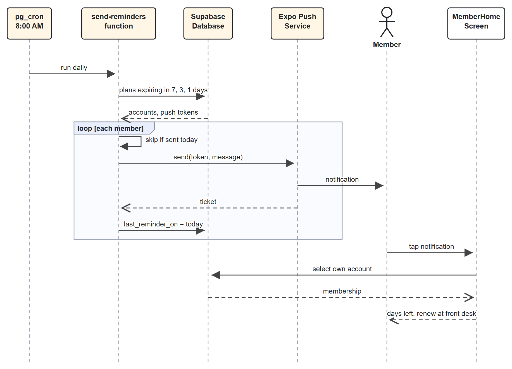

*Figure 20.0 Renewal Reminder Sequence Diagram*

Every day at 8:00 AM, Philippine time, pg_cron starts the send-reminders Edge Function. The function selects the member accounts that have a push token and whose expiry date is exactly 7, 3 or 1 day away, skips any account whose last_reminder_on is already today, and sends each remaining member one push notification through the Expo Push Service, with the messages below. It then sets last_reminder_on to today. When the member taps the notification, NotificationService opens the Home screen, which loads the current membership.

| Days Left | Title | Message |
|---|---|---|
| 7 | Your membership expires in 7 days | Your plan ends on {expiry date}. Renew at the front desk on your next visit. |
| 3 | Your membership expires in 3 days | Your {plan} plan ends on {weekday}, {expiry date}. Renew at the NeoFit front desk to keep it active. |
| 1 | Your membership expires tomorrow | Your plan ends tomorrow, {expiry date}. Renew at the NeoFit front desk to keep it active. |

*Table 26.0 Renewal Reminder Messages*

Because the desktop publishes the new expiry date after every renewal, a member who has already renewed is no longer selected for the old date. If the Expo Push Service reports that a push token is no longer valid, for example after the application was removed from the phone, the function clears the token so that no more reminders are sent to it.

