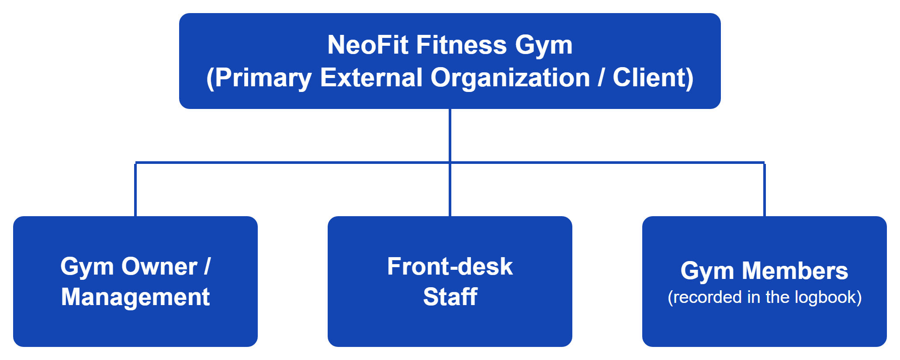
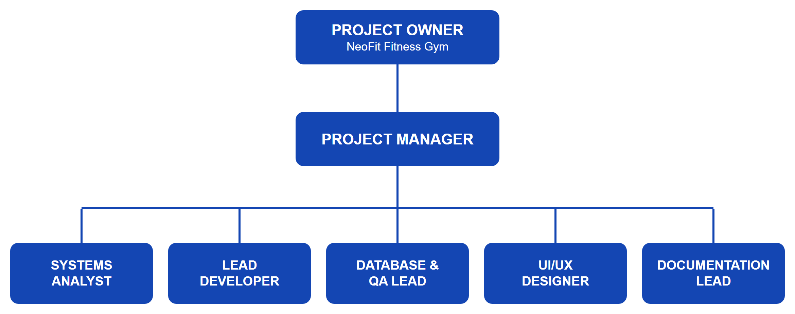
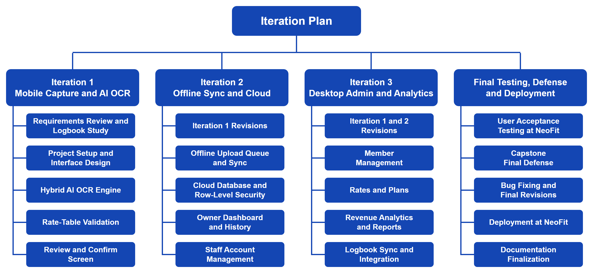

# Software Project Management Plan

*for*

**Revenue Collection and Monitoring System with AI-Integrated Logbook Scanning for NeoFit Fitness Gym**

## 1. Overview

This Software Project Management Plan (SPMP) describes how the Revenue Collection and Monitoring System with AI-Integrated Logbook Scanning for NeoFit Fitness Gym will be planned, organized, developed, monitored and delivered. It serves as the main management reference for the project. It identifies the project deliverables, assigns the roles and responsibilities of each member of the development team, presents the project schedule and the work breakdown, and defines how requirements, schedule, budget, quality and risks are controlled throughout development. The Software Requirements Specification (SRS) describes what the system must do and the Software Design Description (SDD) describes how it is designed, while this document describes how the work of building the system is managed.

NeoFit Fitness Gym records every member visit and payment by hand in a paper logbook, one “name – amount” line per entry, and these pages are its only record of the gym's income. To know how much the gym earned in a day, a month or a year, someone must add up the amounts page by page. This manual tallying takes time and invites errors: misread digits, wrong amounts and lines written twice are hard to notice, so they flow into the totals. Paper records are also hard to search and summarize, and they can be lost or damaged. Encoding the logbook into a system by hand would be just as slow and tiring for a busy front desk, line by line. The project was undertaken to address these problems.

The Revenue Collection and Monitoring System with AI-Integrated Logbook Scanning is a mobile and desktop system that keeps the paper logbook and turns it into revenue records. The staff photograph a logbook page with the mobile application, so that nobody has to encode the entries by hand. An artificial intelligence (AI) optical character recognition (OCR) engine reads the handwritten member names and payment amounts, checks each amount against NeoFit's official rate table, and presents the results to the staff for review and confirmation before they are saved.

The system has three parts. The mobile application, built with React Native, is used by the staff, the owner and the gym's members. It reads pages with Google Gemini 2.5 Flash when the phone is online and with Google ML Kit on the device when it is offline, and it keeps confirmed pages in a local queue until they can be uploaded. Invited members use it to see their own membership, payments and receipts, NeoFit's rates and announcements, and they receive reminders before their plans expire; they still pay at the front desk. A cloud database on Supabase stores the uploads and enforces role-based access. A Windows desktop application, built with Electron, manages members, their payments, rates and announcements, invites members to the member screens, and turns the synchronized logbook data into revenue analytics and reports.

The project will follow an Agile approach with three development iterations followed by final testing, defense and deployment. Each iteration will build a set of features, validate them with NeoFit, and test them with actual logbook pages.

The project covers requirements analysis, system and database design, development of the mobile and desktop applications, integration with the AI services and the cloud database, security implementation, testing, documentation, deployment at NeoFit Fitness Gym, and the capstone defense.

### 1.1. Project Summary

The project is intended to collect and monitor the revenue recorded in the handwritten logbook of NeoFit Fitness Gym and to give the owner accurate and timely revenue information. The system provides the staff with a mobile application for capturing and confirming logbook pages, and provides the owner and the administrator with mobile and desktop tools for monitoring revenue and managing members and rates. Invited members can follow their own membership and payments, and they are reminded to renew on time.

The central component of the project is a two-tier AI OCR engine. The online tier sends the page image to Google Gemini 2.5 Flash, a multimodal vision model, which returns the entries as structured data. The offline tier uses Google ML Kit on the phone together with a rule-based parser that corrects common misreadings. Every extracted amount is compared with the gym's rate table so that unusual values are flagged for the staff to check.

The project will be implemented through three iterations followed by a final phase. Iteration 1 focuses on mobile capture, the AI OCR engine and the review screen. Iteration 2 focuses on offline synchronization, the cloud database, role-based access and the owner's mobile tools. Iteration 3 focuses on the desktop application, revenue analytics and reports, and the member screens with renewal reminders. The final phase covers user acceptance testing at NeoFit, the capstone defense, revisions, deployment and documentation.

The completed project will deliver the mobile application, the desktop administration application, the cloud database, the project documentation, the test results, a user manual, and the deployed system at NeoFit Fitness Gym.

#### 1.1.1. Purpose, Scope and Objectives

The purpose of the system is to let NeoFit Fitness Gym keep its familiar paper logbook while turning its entries into revenue records without manual encoding. By converting handwritten lines into checked records, the system removes the manual tallying of revenue, reduces errors, and gives the owner an up-to-date view of the gym's revenue. Giving members their own view of their membership, and reminding them before it expires, supports on-time renewals and therefore the gym's revenue collection.

The system will provide the following features to its target users:

- **Logbook Capture Module Functionalities**
  - **Page Capture:** Lets the staff photograph a logbook page inside a frame guide, or import a photo from the gallery.
  - **Log Date Selection:** Lets the staff assign a scan to today or to an earlier date, so that older pages can be backfilled.
  - **Daily AI Scan Counter:** Shows how many online AI scans remain for the day and blocks new online scans when the limit is reached.
- **AI OCR Module Functionalities**
  - **Online Extraction:** Sends the page to Google Gemini 2.5 Flash, which reads rotated pages and multi-column tables and returns member names and amounts as structured data.
  - **Offline Extraction:** Reads the page on the device with Google ML Kit when there is no internet connection.
  - **Text Cleanup:** Corrects common misreadings, such as the letter O read as zero, and removes row numbers and payment tags such as “G-Cash”.
- **Validation and Review Module Functionalities**
  - **Rate-Table Check:** Flags any amount that is not an official NeoFit rate.
  - **Duplicate Detection:** Marks repeated lines with the same name and amount during offline reading.
  - **Entry Review:** Lets the staff edit, delete or add entries and confirm the page before it is saved.
- **Offline Synchronization Module Functionalities**
  - **Local Upload Queue:** Keeps confirmed pages on the phone when the internet connection is unavailable.
  - **Automatic Synchronization:** Uploads queued pages to the cloud database the next time the application synchronizes.
  - **Sync Status:** Shows which uploads are synced and which are still pending.
- **Owner Monitoring Module Functionalities**
  - **Revenue Dashboard:** Shows the revenue for the day, week, month and year, and a seven-day trend.
  - **Revenue History:** Lists every upload, the staff member who scanned it, and its entries.
  - **Staff Account Management:** Lets the owner disable or re-enable staff accounts.
  - **Data Export:** Exports revenue records as a CSV file.
- **Gym Management Module Functionalities (Desktop)**
  - **Member Management:** Maintains member profiles, photos, plans and membership status, including renewals, and records every payment with a receipt number.
  - **Rates and Announcements:** Lets the administrator edit NeoFit's price matrix, which the revenue computations then use, and post announcements for members.
  - **Logbook Management:** Shows the synchronized logbook entries by date and lets the administrator edit or delete them.
- **Revenue Analytics Module Functionalities (Desktop)**
  - **Revenue Totals and Trends:** Computes daily, monthly and yearly revenue and charts the daily revenue with the peak day.
  - **Revenue Reconciliation:** Combines the logbook scans and the member payments while counting each payment only once.
  - **Revenue Reports:** Produces breakdowns by source and by plan, and exports a revenue report as a Word document.
- **Member Access Module Functionalities**
  - **Member Invites:** Lets the administrator invite a member to the member screens from the desktop; the member signs in with an email address and password, using a one-time code sent by email to create the password the first time or after forgetting it, and can change the password.
  - **My Membership:** Shows the member's plan, expiry date, days left and status.
  - **Payment History and Receipts:** Shows only the payments recorded on the member's own record, each with a receipt that can be saved as a PDF file or shared.
  - **Rates and Announcements:** Shows NeoFit's official rates and the gym's announcements.
  - **Renewal Reminders:** Sends a push notification 7, 3 and 1 day before the plan expires, reminding the member to renew at the front desk.
- **User and Access Management Module Functionalities**
  - **User Authentication:** Requires the staff, the owner, the administrator and invited members to sign in.
  - **Role-Based Access Control:** Limits features by role: the staff scan and review, the owner also sees revenue and manages staff, and a member sees only their own records.
  - **Data Protection:** Uses database row-level security and encrypted connections to protect the records.

The general objective of the project is to develop the Revenue Collection and Monitoring System with AI-Integrated Logbook Scanning, a system that scans NeoFit Fitness Gym's handwritten logbook with AI and turns it into accurate, searchable revenue records and analytics. Specifically, the project aims to:

1. Extract member names and payment amounts from photos of handwritten logbook pages, both online and offline.
2. Check every extracted amount against NeoFit's official rate table and let the staff review the entries before saving.
3. Keep records safe when there is no internet connection and synchronize them automatically afterwards.
4. Provide daily, weekly, monthly and yearly revenue information with breakdowns and downloadable reports.
5. Manage members and rates in one desktop administration application.
6. Give invited members access to their own membership, payments and receipts, and remind them before their plans expire, to support on-time renewals.
7. Restrict access to records and features according to user roles.

#### 1.1.2. Assumptions and Constraints

The following assumptions were made in planning the project:

- NeoFit Fitness Gym will continue to record member visits and payments in its paper logbook as “name – amount” lines.
- The front-desk staff and the owner have Android smartphones with a working camera.
- The gym has at least one Windows computer for the desktop administration application.
- Internet access at the gym is available most of the time but may be slow or interrupted.
- Logbook entries are handwritten legibly enough for a person to read them.
- Every member gives the front desk an email address, and members who use the member screens have an Android smartphone.
- NeoFit will designate its owner or an authorized representative to provide requirements, sample logbook pages, feedback and acceptance.

The system is designed as a mobile and desktop system connected through a cloud database. Therefore, the system will be developed and implemented using the following technologies:

- **Mobile Application:** React Native (Expo), TypeScript
- **Desktop Application:** Electron, React, Vite
- **Local Desktop API:** Express (Node.js)
- **Cloud Database:** Supabase (PostgreSQL), with authentication, row-level security and Edge Functions
- **Local Desktop Database:** SQLite
- **Online OCR:** Google Gemini 2.5 Flash API
- **Offline OCR:** Google ML Kit Text Recognition
- **Push Notifications:** Expo Notifications and the Expo Push Service

The project is also subject to the following constraints:

- The project must follow the IT 428 capstone schedule and submission deadlines.
- The project relies on free service tiers; online AI scans are limited to five per day to stay within the Gemini API quota.
- The mobile application targets Android, including its member screens.
- The system records the payments made at the front desk but does not accept online payments.
- The scope is limited to one gym branch.
- The handling of member names and payments must comply with the Data Privacy Act of 2012 (Republic Act No. 10173).

#### 1.1.3. Project Deliverables

All of the items listed in this subsection are to be delivered before the completion of the project.

- Mobile application for Android, for the staff, the owner and members
- Desktop administration application for Windows
- Cloud database with authentication and row-level security
- Hybrid AI OCR engine (online and offline)
- Logbook Capture, Validation and Review, and Offline Synchronization Modules
- Owner Monitoring Module
- Gym Management and Revenue Analytics Modules
- Member Access Module (member screens, invites and renewal reminders)
- User and Access Management Module
- Software Documentation (Software Engineering Documents)
  - Software Project Management Plan (SPMP)
  - Software Requirements Specification (SRS)
  - Software Design Description (SDD)
  - Software Test Document (STD)
- System testing and evaluation results, including OCR accuracy tests on actual NeoFit logbook pages
- Database and system configuration
- User interface and system prototype
- User manual and orientation materials for the NeoFit staff, owner and members
- System deployment on the devices of NeoFit Fitness Gym

#### 1.1.4. Schedule and Budget Summary

The project schedule follows the IT 428 capstone calendar. The table below lists the major milestones. Because the project mainly uses software and free service tiers, the budget covers operating expenses such as internet connectivity, transportation to NeoFit, and documentation printing. The detailed budget is presented in Section 3.2.4.

| Milestone Task | Date Started | Completion Date |
|---|---|---|
| Project Proposal and Documents (Title, SPMP, SRS, SDD) | September 28, 2026 | October 23, 2026 |
| Development Phase I – Mobile Capture, AI OCR and Review | October 5, 2026 | October 30, 2026 |
| Software Test I | November 2, 2026 | November 6, 2026 |
| Development Phase II – Offline Sync, Cloud Database and Roles | November 9, 2026 | December 4, 2026 |
| Software Test II | December 7, 2026 | December 11, 2026 |
| Development Phase III – Desktop Administration, Revenue Analytics and Member Access | January 4, 2027 | February 5, 2027 |
| Final Testing, Defense and Deployment | February 8, 2027 | March 12, 2027 |
| Submission of Hardbound Documents | March 15, 2027 | April 2, 2027 |

*Table 1.0 Milestone Task*

### 1.2. Evolution of Plan

All changes to this Software Project Management Plan must be reviewed and approved by the Project Manager and the development team before implementation. Any modification to the system requirements, user roles, database structure, system modules, AI OCR engine, synchronization process or system architecture shall be documented to keep the project records consistent and current.

The plan may evolve because of changes in user requirements, technical limitations, the quality of the handwriting in the logbook, internet connectivity at the gym, limits of the AI services, or improvements identified during development and testing.

All approved changes must be reflected in the official project documents. Before implementing a change, the team shall review its effect on the project scope, schedule, budget, resources and system functionality. Each revision of this plan shall carry a new version number, a date and a description of the changes.

### 1.3. Definition, Acronyms, and Abbreviations

The table below defines the terms, acronyms and abbreviations used in this document.

| Terms | Definition |
|---|---|
| The system | The Revenue Collection and Monitoring System with AI-Integrated Logbook Scanning for NeoFit Fitness Gym, developed in this project. |
| NeoFit Fitness Gym | The client organization for which the system is developed and deployed. |
| Logbook | The paper notebook in which the gym staff handwrite the daily member visits and payments, one “name – amount” line per entry. |
| Logbook Scanning | Photographing a logbook page so that AI reads its entries, instead of encoding them by hand. |
| Upload | One captured logbook page together with the entries saved from it. |
| Entry | One line of the logbook: a member name and, when written, a payment amount. |
| OCR | Optical Character Recognition. Technology that converts the text in an image into machine-readable text. |
| AI | Artificial Intelligence. In this project, a machine learning model that reads handwriting from images. |
| Google Gemini 2.5 Flash | A multimodal AI model by Google, used through its API to read logbook pages when the phone is online. |
| Google ML Kit | Google's on-device machine learning library. Its text recognition feature reads pages when the phone is offline. |
| Hybrid (Two-Tier) OCR | The combination of online AI extraction and offline on-device OCR used by the system. |
| Rate Table | NeoFit's official price list for each plan: regular or student/senior; monthly, semi-monthly or daily; with or without treadmill. |
| Rate-Table Check | The validation that flags any extracted amount that is not in the rate table. |
| Offline-First | A design in which the application keeps working and saves data without an internet connection. |
| Offline Upload Queue | Storage on the phone that holds confirmed pages until they can be uploaded. |
| Synchronization | The process of uploading records stored on the phone to the cloud database. |
| Backfill | Scanning an older logbook page and recording it under its original date. |
| Reconciliation | Combining the revenue from the logbook scans and the member payments so that each payment is counted only once. |
| Member Screens | The part of the mobile application for invited gym members, where each member sees only their own membership, payments and receipts, the rates and the announcements. |
| Email Code | A one-time number that the system emails to an invited member, used to sign in for the first time or after the password is forgotten. It works once and expires after one hour. |
| Receipt | The record of one member payment, with a receipt number, shown in the member's payment history. It is not an official receipt of the Bureau of Internal Revenue (BIR). |
| Renewal Reminder | A push notification that tells a member that the plan expires in 7, 3 or 1 days. |
| Push Notification | A message sent to a phone that appears even when the application is closed. |
| Supabase | A cloud platform that provides the PostgreSQL database and the user authentication used by the system. |
| PostgreSQL | The relational database management system used as the system's cloud database. |
| Row-Level Security (RLS) | A database feature that restricts which records each user may read or change. |
| SQLite | A lightweight database embedded in the desktop application for members, rates and settings. |
| React Native | A framework for building mobile applications with JavaScript or TypeScript. |
| Expo / EAS | A platform and build service for React Native, used to build the Android installer and publish updates. |
| Expo Push Service | The notification service of the Expo platform, used to deliver the renewal reminders. |
| Edge Function | A small program that runs inside Supabase on request or on a schedule, used for member invites and the daily reminders. |
| Electron | A framework for building desktop applications with web technologies. |
| Express | A Node.js web framework used for the local API of the desktop application. |
| API | Application Programming Interface. A set of rules that allows software components to communicate. |
| Authentication | The process of verifying the identity of a user before granting access. |
| RBAC | Role-Based Access Control. Granting permissions according to the role of each user. |
| Staff | Front-desk personnel who scan and review logbook pages. |
| Owner | The gym owner, who monitors revenue and manages staff accounts. |
| Administrator | The user of the desktop application who manages members, rates and logbook entries. |
| Member | A NeoFit member who has been invited to the member screens of the mobile application. |
| CSV | Comma-Separated Values. A plain-text file format for tabular data. |
| UI / UX | User Interface / User Experience. |
| UAT | User Acceptance Testing. Testing performed by the client to confirm that the system meets its needs. |
| SPMP, SRS, SDD, STD | Software Project Management Plan, Software Requirements Specification, Software Design Description and Software Test Document. |
| Data Privacy Act of 2012 | Republic Act No. 10173, the Philippine law that protects personal information. |

*Table 2.0 Definition, Acronyms, and Abbreviations*

### 1.4. References

[1] Meta Platforms, Inc., “React Native Documentation.” Web. https://reactnative.dev/docs/getting-started Accessed 2026.  
[2] Expo, “Expo Documentation.” Web. https://docs.expo.dev/ Accessed 2026.  
[3] Google, “Gemini API Documentation.” Web. https://ai.google.dev/gemini-api/docs Accessed 2026.  
[4] Google, “ML Kit Text Recognition v2.” Web. https://developers.google.com/ml-kit/vision/text-recognition/v2 Accessed 2026.  
[5] Supabase, “Supabase Documentation.” Web. https://supabase.com/docs Accessed 2026.  
[6] PostgreSQL Global Development Group, “PostgreSQL Documentation.” Web. https://www.postgresql.org/docs/ Accessed 2026.  
[7] OpenJS Foundation, “Electron Documentation.” Web. https://www.electronjs.org/docs Accessed 2026.  
[8] React, “React Documentation.” Web. https://react.dev/ Accessed 2026.  
[9] OpenJS Foundation, “Express Documentation.” Web. https://expressjs.com/ Accessed 2026.  
[10] SQLite, “SQLite Documentation.” Web. https://www.sqlite.org/docs.html Accessed 2026.  
[11] OWASP Foundation, “OWASP Top 10: The Ten Most Critical Web Application Security Risks.” Web. https://owasp.org/www-project-top-ten/ Accessed 2026.  
[12] International Organization for Standardization, “ISO/IEC 25010:2011 – Systems and software Quality Requirements and Evaluation (SQuaRE) – System and software quality models.” 2011.  
[13] IEEE, “IEEE Std 830-1998: IEEE Recommended Practice for Software Requirements Specifications.” 1998.  
[14] IEEE, “IEEE Std 1058-1998: IEEE Standard for Software Project Management Plans.” 1998.  
[15] Republic of the Philippines, “Republic Act No. 10173: Data Privacy Act of 2012.” 2012.  

## 2. Project Organization

This section describes the organizational structure of the project. It identifies the organizations that interact with or provide requirements for the project, describes the internal structure of the development team, and defines the roles and responsibilities of each member.

The project organization is established to ensure clear communication, proper delegation of tasks, effective decision-making, and accountability throughout the planning, development, testing and deployment of the system.

### 2.1. External Structure

The project team will coordinate with NeoFit Fitness Gym as the primary external organization and the client of the system. The gym will provide the business requirements, sample logbook pages, feedback and validation needed during development.

*Figure 1.0 External Structure*

The primary external stakeholders include:

- **NeoFit Owner / Management:** Provides requirements and sample logbook pages, approves changes, and signs the acceptance of the system.
- **Front-desk Staff:** The main users of the mobile application; they scan the logbook and give feedback on usability.
- **Gym Members:** Their names and payments are recorded in the logbook. Invited members use the member screens of the mobile application to see their own membership, payments and receipts, and they receive renewal reminders.
- **Technical Adviser (Eric Bulala):** Provides technical guidance and reviews milestone reports.
- **Subject Adviser (Clark Kevin V. Villamor, MIT, Head, College of Computer Studies):** Reviews the project scope, title and documents.
- **Capstone Panel:** Evaluates the proposal and the final system during the hearings and the defense.
- **Service Providers (Google, Supabase and Expo):** Provide the AI, database and notification services on which the system depends.

Communication with external stakeholders will be conducted through meetings, consultations, demonstrations, testing sessions and feedback sessions. Requirements and approved changes from NeoFit shall be documented and reviewed by the project team.

### 2.2. Internal Structure

The project will be managed by a development team responsible for planning, designing, developing, testing, documenting and deploying the system. Each member is assigned specific responsibilities based on their role and area of expertise.

*Figure 2.0 Internal Structure*

The internal project organization consists of the following roles:

- **Project Manager:** Leads planning and coordination, and reports to NeoFit and the advisers.
- **Systems Analyst:** Gathers and validates the requirements.
- **Lead Developer:** Builds the mobile and desktop applications and their integrations.
- **Database & QA Lead:** Designs the databases and leads testing.
- **UI/UX Designer:** Designs the user interfaces and runs usability tests.
- **Documentation Lead:** Prepares and maintains the project documents.

### 2.3. Roles and Responsibilities

The table below lists the role, the assigned member and the responsibilities of each position in the project.

| Role | Member | Responsibilities |
|---|---|---|
| Project Manager | Jay Mark A. Reños | Overall coordination, schedule and milestone tracking, communication with NeoFit and the advisers, risk management, meeting facilitation, and approval of iteration outputs. |
| Systems Analyst | Liza Mae C. Sugala | Requirements gathering with the NeoFit owner and staff, study of the logbook format, use case specifications, SRS preparation, and validation of requirements. |
| Lead Developer / Programmer (Team Leader) | Rusel R. Portes | Mobile application, hybrid AI OCR engine, offline synchronization, cloud database integration, desktop application, member screens and notifications, builds and deployment. |
| Database & QA Lead | Efren S. Cabudbud Jr. | Cloud and desktop database design, row-level security rules, ERD and data dictionary, test cases, OCR accuracy testing, privacy testing of member data, defect tracking, and STD preparation. |
| UI/UX Designer | Carl Vey P. Sente | Mobile and desktop interface design, prototypes, usability testing with NeoFit staff, and design consistency. |
| Documentation Lead | Rayla G. Lanaza | SPMP, SRS, SDD and STD preparation, user manual, document formatting and packaging, and presentation materials. |

*Table 3.0 Roles and Responsibilities*

## 3. Managerial Process Plans

This section specifies the project management processes that will be followed in the development of the system. The processes are aligned with the approved project scope and are intended to ensure effective planning, resource allocation, risk management, project monitoring and successful completion of the system.

The managerial process plans include the Start-up Plan, the Work Plan, the Control Plan, the Risk Management Plan and the Project Closeout Plan. These processes will guide the development team from the initial planning and requirements gathering to the deployment and completion of the project.

### 3.1. Start-up Plan

The Start-up Plan defines the activities required to formally begin the development of the system. It covers project estimation, staffing, resource acquisition and the preparation of project personnel, so that the team has the skills, tools, resources and understanding of the requirements needed before the main development activities begin.

#### 3.1.1. Estimation Plan

The proponents will use an Agile Software Development approach because the requirements may change based on feedback from NeoFit, testing results, and the accuracy of the AI on actual logbook pages. The Agile approach allows the team to evaluate and improve the system continuously throughout development.

The development is divided into iterations. Each iteration includes planning, development, testing, evaluation and refinement of selected functionalities. Each iteration ends with working software that is reviewed with NeoFit before the next iteration begins.

The planned development iterations are as follows:

- **Iteration 1 – Mobile Capture, AI OCR and Review:** Requirements review, logbook study, project setup and interface design, the hybrid AI OCR engine, rate-table validation and the review screen.
- **Iteration 2 – Offline Sync, Cloud Database and Roles:** The offline upload queue, synchronization, the cloud database, authentication, row-level security, and the owner's dashboard, history and staff management.
- **Iteration 3 – Desktop Administration, Revenue Analytics and Member Access:** Members, payments, rates, announcements, revenue analytics, reconciliation, reports and logbook synchronization on the desktop, and the member screens with invites, receipts and renewal reminders.
- **Final Testing, Defense and Deployment:** User acceptance testing at NeoFit, the capstone defense, bug fixing, deployment and documentation finalization.

*Figure 3.0 Iteration Plan*

The number of iterations may be adjusted if additional requirements, technical issues or necessary improvements are identified during development. Any major change that affects the scope, schedule or resources shall be reviewed and approved before implementation.

Estimation will consider the following factors:

- Complexity of each system module
- Number and type of required functionalities
- Development and testing effort
- Accuracy tuning of the AI OCR engine on real logbook pages
- Quotas and limits of the AI and cloud services
- Offline storage and synchronization requirements
- Security and data protection requirements, including the privacy of member data in the member screens
- Availability and skills of the team members
- Time required for documentation and deployment
- Feedback and changes requested by NeoFit

#### 3.1.2. Staffing Plan

The table below shows the members involved in the development of the system.

| Name | Position | Status |
|---|---|---|
| Jay Mark A. Reños | Project Manager | Full Time |
| Liza Mae C. Sugala | Systems Analyst | Full Time |
| Rusel R. Portes | Lead Developer / Team Leader | Full Time |
| Efren S. Cabudbud Jr. | Database & QA Lead | Full Time |
| Carl Vey P. Sente | UI/UX Designer | Full Time |
| Rayla G. Lanaza | Documentation Lead | Full Time |

*Table 4.0 Staff and Person Involved in Project*

#### 3.1.3. Resource Acquisition Plan

All software, development tools and services required for the system will be identified and prepared by the project team before and during development. The main technologies are React Native, Electron, Supabase, SQLite, the Google Gemini API and Google ML Kit, together with development computers, Android test phones, internet connectivity and documentation tools. All software and services used are free or run on free tiers.

For the requirements, the team will coordinate with the owner of NeoFit Fitness Gym. The team will prepare the appropriate request letter and a client partnership and confidentiality agreement, and it will conduct interviews, consultations and observations of the front-desk logging process. Sample logbook pages will be collected with the gym's consent for requirements analysis and for testing the accuracy of the OCR engine.

Logbook pages and member information provided by NeoFit will be used only for system analysis, development, testing and documentation. Access to this information will be limited to the project members and authorized stakeholders.

#### 3.1.4. Project Staffing Plan

The team members have the basic knowledge and skills in software development, systems analysis, database management, interface design and software testing required for the project. However, project-specific orientation and technical familiarization will be conducted when necessary, particularly for the AI and synchronization features of the system.

Training and orientation activities may include:

- Familiarization with the approved requirements and project scope.
- Review of the development workflow and coding standards.
- React Native and Expo development for the mobile application.
- Electron, Express and SQLite development for the desktop application.
- Supabase database design, authentication and row-level security.
- Use of the Gemini API and ML Kit, and the evaluation of OCR accuracy.
- Offline storage and synchronization.
- Supabase Edge Functions and push notifications with Expo.
- The Data Privacy Act of 2012 and the handling of member information.
- Testing procedures and documentation standards.

The Project Manager and the Lead Developer will coordinate the necessary training and knowledge-sharing activities. Team members may also conduct self-learning, technical discussions and peer-to-peer knowledge sharing throughout the project.

### 3.2. Work Plan

This section describes the decomposition of the total scope of work for the system. The work plan identifies the major project tasks and their estimated schedules.

The development is divided into iterations following the Agile approach. Each iteration focuses on specific functionalities and includes development, integration, testing, evaluation and necessary revisions.

| No. | Project Task | Estimated Schedule |
|---|---|---|
| **1.** | **Iteration 1 – Mobile Capture, AI OCR and Review** | **October 5 – November 6, 2026** |
| 1.1 | Requirements Review and Logbook Study | October 5 – October 9, 2026 |
| 1.2 | Project Setup and Interface Design | October 12 – October 16, 2026 |
| 1.3 | Hybrid AI OCR Engine (Gemini 2.5 Flash and ML Kit) | October 19 – October 23, 2026 |
| 1.4 | Rate-Table Validation and Review Screen | October 26 – October 30, 2026 |
| 1.5 | Software Testing I | November 2 – November 6, 2026 |
| **2.** | **Iteration 2 – Offline Sync, Cloud Database and Roles** | **November 9 – December 11, 2026** |
| 2.1 | Iteration 1 Revisions | November 9 – November 13, 2026 |
| 2.2 | Offline Upload Queue and Synchronization | November 16 – November 20, 2026 |
| 2.3 | Cloud Database, Authentication and Row-Level Security | November 23 – November 27, 2026 |
| 2.4 | Owner Dashboard, Revenue History and Staff Management | November 30 – December 4, 2026 |
| 2.5 | Software Testing II | December 7 – December 11, 2026 |
| **3.** | **Iteration 3 – Desktop Administration, Revenue Analytics and Member Access** | **January 4 – February 5, 2027** |
| 3.1 | Iteration 1 and 2 Revisions | January 4 – January 8, 2027 |
| 3.2 | Members, Payments, Rates and Announcements | January 11 – January 15, 2027 |
| 3.3 | Revenue Analytics, Reconciliation and Reports | January 18 – January 22, 2027 |
| 3.4 | Member Screens, Receipts and Renewal Reminders | January 25 – January 29, 2027 |
| 3.5 | Logbook Sync, Integration and Software Testing III | February 1 – February 5, 2027 |
| **4.** | **Final Testing, Defense and Deployment** | **February 8 – March 12, 2027** |
| 4.1 | User Acceptance Testing at NeoFit | February 8 – February 12, 2027 |
| 4.2 | Capstone Final Defense | February 8 – February 19, 2027 |
| 4.3 | Final Revisions and Bug Fixing | February 22 – March 5, 2027 |
| 4.4 | Deployment and Documentation Finalization | March 8 – March 12, 2027 |

*Table 5.0 Work Plan*

#### 3.2.1. Work Activities

The work activity table specifies the major activities for each project task and iteration, the role assigned to each activity, and the estimated labor hours required.

| No. | Project Task / Activity | Role | Labor Hours |
|---|---|---|---|
| **1.** | **Iteration 1** |  | **264 hrs** |
| 1.1 | **Requirements Review and Logbook Study** |  | 56 hrs |
|  | Interviews with the NeoFit owner and staff | Systems Analyst | 16 hrs |
|  | Collection and analysis of sample logbook pages | Systems Analyst | 16 hrs |
|  | Backlog and iteration planning | Project Manager | 8 hrs |
|  | Requirements review | Database & QA Lead | 16 hrs |
| 1.2 | **Project Setup and Interface Design** |  | 40 hrs |
|  | Development environment and repository setup | Lead Developer | 16 hrs |
|  | Build and deployment setup | Lead Developer | 8 hrs |
|  | Interface design of the mobile and desktop screens | UI/UX Designer | 16 hrs |
| 1.3 | **Hybrid AI OCR Engine** |  | 64 hrs |
|  | Gemini prompt and response handling | Lead Developer | 24 hrs |
|  | ML Kit fallback and text parser | Lead Developer | 24 hrs |
|  | OCR accuracy test set from NeoFit pages | Database & QA Lead | 16 hrs |
| 1.4 | **Rate-Table Validation and Review Screen** |  | 56 hrs |
|  | Validation rules | Lead Developer | 24 hrs |
|  | Review screen design | UI/UX Designer | 16 hrs |
|  | Software testing | Database & QA Lead | 16 hrs |
| 1.5 | **Software Testing I** |  | 48 hrs |
|  | Functional testing | Database & QA Lead | 24 hrs |
|  | Bug fixing and verification | Lead Developer | 24 hrs |
| **2.** | **Iteration 2** |  | **280 hrs** |
| 2.1 | **Iteration 1 Revisions** |  | 40 hrs |
|  | Development revisions | Lead Developer | 24 hrs |
|  | Software testing | Database & QA Lead | 16 hrs |
| 2.2 | **Offline Upload Queue and Synchronization** |  | 56 hrs |
|  | Queue and synchronization development | Lead Developer | 32 hrs |
|  | Network-loss and recovery testing | Database & QA Lead | 24 hrs |
| 2.3 | **Cloud Database, Authentication and Row-Level Security** |  | 64 hrs |
|  | Schema and row-level security design | Database & QA Lead | 24 hrs |
|  | Authentication and role integration | Lead Developer | 24 hrs |
|  | Security testing | Database & QA Lead | 16 hrs |
| 2.4 | **Owner Dashboard, Revenue History and Staff Management** |  | 64 hrs |
|  | Interface design | UI/UX Designer | 16 hrs |
|  | Module development | Lead Developer | 32 hrs |
|  | Software testing | Database & QA Lead | 16 hrs |
| 2.5 | **Software Testing II** |  | 56 hrs |
|  | System testing | Database & QA Lead | 40 hrs |
|  | Approval | Project Manager | 16 hrs |
| **3.** | **Iteration 3** |  | **352 hrs** |
| 3.1 | **Iteration 1 and 2 Revisions** |  | 40 hrs |
|  | Development revisions | Lead Developer | 24 hrs |
|  | Software testing | Database & QA Lead | 16 hrs |
| 3.2 | **Members, Payments, Rates and Announcements** |  | 80 hrs |
|  | Desktop database design | Database & QA Lead | 16 hrs |
|  | Module development | Lead Developer | 32 hrs |
|  | Payment records, receipts and announcements | Lead Developer | 16 hrs |
|  | Software testing | Database & QA Lead | 16 hrs |
| 3.3 | **Revenue Analytics, Reconciliation and Reports** |  | 72 hrs |
|  | Revenue rules and reconciliation | Lead Developer | 32 hrs |
|  | Report export | Lead Developer | 16 hrs |
|  | Accuracy testing against manual tallies | Database & QA Lead | 24 hrs |
| 3.4 | **Member Screens, Receipts and Renewal Reminders** |  | 96 hrs |
|  | Member screen design | UI/UX Designer | 16 hrs |
|  | Member sign-in, screens and receipts | Lead Developer | 32 hrs |
|  | Invites, member data publishing and reminders | Lead Developer | 24 hrs |
|  | Privacy and access testing | Database & QA Lead | 16 hrs |
|  | Reminder testing on members' phones | Database & QA Lead | 8 hrs |
| 3.5 | **Logbook Sync, Integration and Software Testing III** |  | 64 hrs |
|  | System integration | Lead Developer | 24 hrs |
|  | System testing | Database & QA Lead | 24 hrs |
|  | Approval | Project Manager | 16 hrs |
| **4.** | **Final Testing, Defense and Deployment** |  | **208 hrs** |
| 4.1 | **User Acceptance Testing at NeoFit** |  | 48 hrs |
|  | User acceptance test | Database & QA Lead | 24 hrs |
|  | Feedback and evaluation | Systems Analyst | 16 hrs |
|  | Approval | Project Manager | 8 hrs |
| 4.2 | **Capstone Final Defense** |  | 40 hrs |
|  | Presentation and demonstration | Project Manager | 16 hrs |
|  | Presentation materials | Documentation Lead | 16 hrs |
|  | Demonstration setup | Lead Developer | 8 hrs |
| 4.3 | **Final Revisions and Bug Fixing** |  | 56 hrs |
|  | Bug fixing | Lead Developer | 40 hrs |
|  | Verification | Database & QA Lead | 16 hrs |
| 4.4 | **Deployment and Documentation Finalization** |  | 64 hrs |
|  | Deployment at NeoFit | Lead Developer | 16 hrs |
|  | Deployment verification | Database & QA Lead | 8 hrs |
|  | Documentation | Documentation Lead | 32 hrs |
|  | Final review | Project Manager | 8 hrs |
|  | **Total** |  | **1104 hrs** |

*Table 6.0 Work Activities*

#### 3.2.2. Schedule Allocation

The project duration is divided into three iterations followed by the final testing, defense and deployment phase. Each iteration is allocated a specific amount of working time based on the complexity and number of its tasks. The schedule follows the IT 428 capstone calendar and may be adjusted because of changes in requirements, testing results, technical issues, the academic calendar, or other approved modifications.

#### 3.2.3. Resource Allocation

The development team has a fixed amount of time available for the project. Based on the estimated labor hours in the work activities, the team is allocated approximately 264 labor hours for Iteration 1, 280 labor hours for Iteration 2, 352 labor hours for Iteration 3, and 208 labor hours for the Final Testing, Defense and Deployment phase, for a total of 1104 labor hours.

The allocated labor hours cover requirements analysis, design, development, AI OCR tuning, synchronization, security, testing, revisions, deployment and documentation. The allocation may be adjusted depending on project progress, team availability and approved changes in requirements.

#### 3.2.4. Budget Allocation

The project will mainly use the existing devices and development tools of the proponents and the free tiers of the cloud and AI services. The budget covers the operating expenses listed in the table below. Any additional expense shall be reviewed by the team and documented.

| Item | Estimated Cost (PHP) | Notes |
|---|---|---|
| Development computers and Android phones | 0 | Team-owned devices |
| Supabase (cloud database, authentication and Edge Functions) | 0 | Free tier |
| Google Gemini API | 0 | Free tier; the app limits online scans to five per day |
| Expo EAS builds and updates | 0 | Free tier |
| Expo push notifications | 0 | Free |
| GitHub repository and releases | 0 | Free |
| Mobile data and internet for testing | 1,000 – 2,000 | Shared by the team |
| Transportation to NeoFit | 500 – 1,500 | Interviews, UAT and deployment |
| Documentation printing and binding | 1,500 – 3,000 | Includes hardbound copies |
| Total | 3,000 – 6,500 |  |

*Table 7.0 Budget Allocation*

### 3.3. Control Plan

This section specifies the metrics, reporting mechanisms and control procedures used to measure, report and control the requirements, schedule, resources, quality and development activities of the system.

The control procedures will be used throughout the project to keep development aligned with the approved scope, schedule, requirements and quality standards. Significant changes identified during development will be reviewed and documented by the project team.

#### 3.3.1. Requirements Control Plan

System requirements will be managed and documented through the Software Requirements Specification (SRS) and its use case descriptions. Requirements may change based on feedback from NeoFit, testing results, or changes in the gym's processes and rates.

All proposed changes shall be reviewed by the Project Manager and the Systems Analyst to determine their effect on the project scope, schedule, resources and functionality. Approved changes shall be recorded in the project documents and communicated to the development team before implementation. Changes that affect the AI OCR engine or the handling of member data also require review by the Lead Developer.

#### 3.3.2. Schedule Control Plan

The team will hold weekly progress meetings, supervised by the Project Manager, to review completed tasks, current activities, problems encountered and upcoming work. Each member will report progress and any issue that may affect the schedule, and the Project Manager will compare actual progress with the planned schedule.

At the end of each iteration, the team will hold a retrospective meeting to evaluate its performance, identify problems, and decide on improvements for the next iteration. A delay of more than one week on any task shall be escalated to the Project Manager.

#### 3.3.3. Budget Control Plan

The project will mainly use the existing resources of the proponents and free service tiers. Expenses such as internet connectivity, transportation, and documentation printing will be monitored throughout the project. Usage of the Gemini API and the cloud database will also be monitored so that the project stays within the free quotas.

#### 3.3.4. Quality Control Plan

The Database & QA Lead will prepare and maintain the Software Test Document (STD), which contains the test cases, testing procedures, results and identified defects.

Quality control will be performed through unit, functional, integration, usability, security and user acceptance testing. Special attention will be given to the accuracy of the AI OCR engine, which will be measured by comparing its output with a careful manual transcription of the same logbook pages, and to the reliability of offline synchronization and revenue computations. Identified defects will be documented, assigned to the appropriate developer, corrected and verified.

A more detailed quality assurance and testing procedure will be presented in the Software Test Document.

#### 3.3.5. Reporting Plan

The development team will provide progress reports to the Project Manager at the end of each iteration, and milestone reports to the Technical Adviser and the Subject Adviser. The reports will summarize completed activities, current progress, identified issues, testing results and the plan for the next iteration.

Weekly meetings and the team's group chat will also serve as channels for reporting accomplishments, problems and project status. Major issues or changes affecting the scope or schedule shall be reported to the Project Manager immediately.

#### 3.3.6. Metrics Collection Plan

Project metrics will be collected throughout development to monitor progress and quality. The following metrics will be used:

- Percentage of completed project tasks.
- Number of completed requirements.
- Number of identified and resolved defects.
- Number of completed and passed test cases.
- Actual labor hours compared with estimated labor hours.
- Iteration completion rate.
- OCR accuracy: the share of names and amounts read correctly on the test set of logbook pages.
- Share of entries flagged by the rate-table check and the share of flags that were real errors.
- Synchronization success rate after offline use.
- Delivery rate of renewal reminders, and the share of invited members who renew before their plans expire.
- System testing and user acceptance results.

The collected metrics will be reviewed during progress meetings and iteration retrospectives to determine whether the project is progressing according to plan.

#### 3.3.7. Risk Management Plan

Project risks will be identified during planning and monitored throughout each iteration. The Project Manager and the team will maintain a prioritized list of risks based on their likelihood and potential impact.

During regular meetings, members will report newly identified risks, technical problems, schedule delays and other issues. Mitigation and contingency actions will be defined for high-priority risks and assigned to responsible members. The main risks identified at the start of the project are listed below.

| Risk | Likelihood | Impact | Mitigation |
|---|---|---|---|
| Low OCR accuracy on untidy handwriting | Medium | High | Keep staff review before saving; flag amounts outside the rate table; tune the AI prompt with a test set of real NeoFit pages. |
| Gemini API quota, cost or outage | Medium | Medium | Limit online scans to five per day; fall back to ML Kit on the device; monitor usage. |
| Weak or no internet at the gym | High | Medium | Offline upload queue with automatic synchronization; offline OCR tier. |
| Late change of capstone title | High | Medium | Start development as soon as the requirements and interface designs are approved; track progress weekly; keep a buffer before each deadline. |
| Mobile and desktop rate tables differ | Medium | Medium | Use one source of rates for both applications; test revenue totals after every rate change. |
| Privacy of member names and payments | Low | High | Collect only what the logbook holds; enforce row-level security; obtain NeoFit's consent; follow RA 10173. |
| Member data exposed through the member screens | Low | High | Invite-only accounts; row-level security on every member table; copy only invited members' records to the cloud; test access with two member accounts. |
| Renewal reminders not delivered | Medium | Low | Show the same reminder on the member's Home screen; test on several Android phones; clear invalid push tokens. |
| Team member unavailability | Medium | High | Shared repository and documentation; cross-training on adjacent tasks. |
| Android device compatibility | Low | Medium | Test on at least two Android devices of different versions before deployment. |

*Table 8.0 Risk Register*

#### 3.3.8. Project Closeout Plan

The development team will ensure the proper closeout of the system after final testing, user acceptance testing, deployment and documentation. The project closeout activities will include:

- Completion of all approved system requirements.
- Resolution and verification of critical defects.
- Completion of final system testing and user acceptance testing.
- Deployment of the mobile and desktop applications at NeoFit Fitness Gym.
- Finalization of the SPMP, SRS, SDD, STD and user manual.
- Turnover of the system, accounts and instructional materials to NeoFit.
- Final review and approval of the project deliverables.
- Documentation of lessons learned and project outcomes.

The Project Manager will confirm that all required deliverables have been completed and accepted before formally closing the project.

## 4. Technical Process Plans

This section specifies the technical processes, development methodology, tools, techniques, infrastructure and product acceptance procedures used in developing the system.

The technical process plans ensure that the system is developed systematically and that the mobile, cloud and desktop functionalities are properly designed, implemented, tested and accepted.

### 4.1. Process Model

The development team will use an Agile Software Development methodology. Agile suits the project because the requirements may change based on feedback from NeoFit, testing results and the accuracy of the AI on real logbook pages.

The project will be developed through a series of iterations. Each iteration focuses on a set of functionalities and includes planning, development, testing, review and revision. This approach allows the team to find issues early and improve the system before the next iteration.

The Agile process will include the following activities:

- **Iteration Planning:** The team identifies and prioritizes the tasks and requirements for the iteration.
- **Development:** The developers implement the assigned functionalities based on the approved requirements.
- **Testing:** The testing team evaluates the developed functionalities and documents any defects.
- **Iteration Review:** The team presents the completed functionalities and gathers feedback from NeoFit and the advisers.
- **Weekly Stand-up Meeting:** Members give updates on completed tasks, current activities and issues.
- **Iteration Retrospective:** The team evaluates its process and identifies improvements for the next iteration.

### 4.2. Methods, Tools, and Technique

The methods and techniques listed in the following table will be applied to the appropriate areas of the system.

| Category | Methods and Techniques |
|---|---|
| Requirements | Interviews with the owner and staff, observation of front-desk logging, collection of sample logbook pages, and requirements analysis |
| Formal Specification and Analysis | Use Case Diagrams, Activity Diagrams, Class Diagrams and other UML models |
| System Design | Wireframes, prototypes, entity-relationship diagrams, and user interface design |
| Development | Agile iterative development, modular components, and separation of screens, services and data access |
| AI and OCR | Prompt design for structured output, on-device text recognition, rule-based text cleanup, and rate-table validation |
| Testing | Unit, functional, integration, OCR accuracy, offline and synchronization, security, usability, and user acceptance testing |
| Data Management | Relational database design, row-level security, data validation, and reconciliation of duplicate records |
| Security | Authentication, role-based access control, invite-only member accounts, hashed passwords, encrypted connections, and least-privilege database rules |
| Documentation | SPMP, SRS, SDD, STD, user manual and other project documents |

*Table 9.0 Methods and Techniques*

#### 4.2.1. Tools

The following tools will be used to develop, test and document the system.

| Category | Tools |
|---|---|
| Operating Systems | Windows, Android |
| Programming Languages | TypeScript, JavaScript, SQL |
| Mobile Framework | React Native (Expo) |
| Desktop Framework | Electron, React, Vite |
| Local API | Express (Node.js) |
| Cloud Database and Authentication | Supabase (PostgreSQL, Auth, Edge Functions) |
| Push Notifications | Expo Notifications, Expo Push Service |
| Local Database | SQLite |
| AI and OCR | Google Gemini 2.5 Flash API, Google ML Kit Text Recognition |
| Build and Distribution | Expo EAS, electron-builder, GitHub Releases |
| Development Environment | Visual Studio Code |
| Version Control | Git and GitHub |
| Design and Diagrams | Figma, draw.io |
| Documentation | Microsoft Word |
| Mobile Testing | Android devices and Android Emulator |

*Table 10.0 Tools*

### 4.3. Infrastructure Plan

The project infrastructure consists of the development computers, Android test phones, the cloud database, the AI services, the development environments, internet connectivity and the version control repository.

The team will use computers capable of running the React Native, Electron, Node.js and SQLite development environments. Android phones and the Android Emulator will be used to test the mobile application, including camera capture and offline behavior. The cloud database, authentication and scheduled functions will run on a Supabase project, the online OCR will use the Google Gemini API, and the renewal reminders will be delivered through the Expo Push Service.

A central Git repository on GitHub will hold the source code. The Android installer will be built with Expo EAS, and the Windows installer will be built with electron-builder and published through GitHub Releases, from which the desktop application updates itself. Internet connectivity is required for development, package installation, AI requests, synchronization and repository updates.

The infrastructure may be adjusted based on technical requirements identified during development and deployment.

### 4.4. Product Acceptance Plan

Upon completion, the system will be presented to the owner of NeoFit Fitness Gym or an authorized representative for evaluation and user acceptance testing. The evaluation will cover the approved requirements, functionality, usability, security, OCR accuracy on the gym's logbook pages, synchronization, revenue reporting, and the member screens and renewal reminders.

After the system passes the required testing and evaluation, the NeoFit representative will be given a Project Acceptance Form to sign as confirmation that the system has been reviewed and accepted. Issues or modifications identified before acceptance will be documented and addressed by the team before final acceptance and deployment.

## 5. Supporting Process Plans

This section contains the supporting processes applied throughout the development of the system. These processes support verification and validation, documentation, quality assurance, and the resolution of problems encountered during the project.

The supporting processes will be performed throughout the project to ensure that the system meets the approved requirements and maintains its quality, and that problems are documented and resolved.

### 5.1. Verification and Validation Plan

The team will create and maintain a separate Software Test Document (STD) for the verification and validation of the system. The STD will contain the test cases, testing procedures, results, identified defects and validation activities needed to determine whether the system meets the specified requirements.

Verification and validation will include unit, functional, integration, OCR accuracy, offline and synchronization, member access and privacy, usability, security and user acceptance testing. OCR accuracy will be validated on logbook pages collected from NeoFit, and revenue computations will be validated against manual tallies of the same days.

### 5.2. Documentation Plan

Several documents will be produced and maintained throughout the project by the assigned members. The following documents will be created and maintained:

- Software Project Management Plan (SPMP)
- Software Requirements Specification (SRS)
- Software Design Description (SDD)
- Software Test Document (STD)
- User Manual for the mobile and desktop applications
- System and Technical Documentation
- Project Acceptance Documentation

All major documents will be reviewed and updated when necessary to reflect approved changes in requirements, design, development, testing results and project decisions.

### 5.3. Quality Assurance Plan

To ensure the quality of the system, the results documented in the Software Test Document will be evaluated to identify functional errors, OCR accuracy problems, usability issues, security concerns and other problems encountered during development and testing.

Problems identified during testing will be documented and assigned to the appropriate developer. After a correction, the affected functionality will be retested to verify that the problem is resolved and that the correction introduces no new errors. All documents will be reviewed by at least two team members before submission.

### 5.4. Problem Resolution Plan

Any major problem encountered during the project shall be reported and discussed during the weekly meetings, or immediately through the team's group chat if it blocks work. Problems may include technical issues, development delays, system defects, OCR accuracy problems, synchronization errors, security issues or changes in user requirements.

The team will identify the cause and possible solutions for each problem. Tasks for resolving the problem will be assigned to the appropriate member and monitored until completion.

For major issues that may affect the scope, schedule, resources or deliverables, the Project Manager will review the issue and decide on the appropriate action. All major problems and their resolutions will be documented for project reference.

